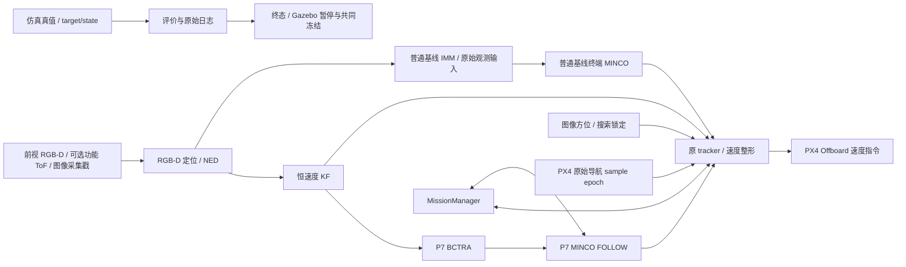

# 当前架构与控制边界

2026-10-21 P7.6.2：最终因果配对候选已执行 A1，旧 bracket 故障未重现；悬停通过，但满推力结束至 Velocity 执行约 240 ms 的滞后导致上升速度超限。A1 未合格、A2/B 未运行，没有 A 资格；详见 [A1 实测与交接阻断](p762_bodyrate_calibration_validation.md)。

2026-10-21 P7.6.1：P76 相机改为模型 FLU (0.35,0,0.55) m，保持 32°/5 m/4 m；完整外壳/支架参与碰撞净空。海面屏障在论文制导外独立撤权，恢复使用有界指令轨迹。新实际校准流程两轮 A1 失败，A2/B/C/D 未执行；最终因果配对修复仅离线验证，正式 P76 继续拒绝未获资格的飞行。详见 [P761 当前结果](p761_paper_architecture_completion.md)。

2026-10-21：本分支新增的显式 P76 候选采用 32° 相机和论文式二维 DKF/PNG/IBVS Body-rate 路径。原点 0.33 m 门槛已由真实碰撞净空/制动保护替代；PX4 未解锁 DDS/模式接口实测通过，但实际动力学、FOLLOW 与捕获尚未取得资格。默认 P7 未切换，详见 [P76 当前修订](p76_32deg_physical_clearance_px4.md)。

2026-10-18：P7 专用配置以 KF/BCTRA → P47/C MINCO 执行 FOLLOW，Y 后撤销 FOLLOW 并由同一 Tracker 执行 IBVS/PNG。一键入口现已默认传入 `--manual --capture`，启用下降并在 0.50 m 三维接触半径内由评价器暂停仿真；底层 P7 入口省略 `--capture` 时仍保持安全高度与 4.5 m 水平间距。P7 启动时不再创建闲置的旧截击 Planner，原研究配置保留。启动和当前实测见 [P7 入口](p7_progress.md)、[捕获](p7_capture.md)与[按需启动](startup_profile.md)；下文 P53 内容保留其阶段上下文。

P5.3最新实际状态见 [全面修复与最终验收](p53_comprehensive_validation.md)：同配置R11的F2/F3均完成，实际MINCO占比100%、零回退；后文P4/P5/P5.1段落保留各阶段时点。控制链仍为BCTRA/MINCO/唯一Tracker速度控制，MPC尚未实现。

当前默认只有前视 RGB-D 输入，下视关闭；升沉幅值 0.15 m。ToF 实现保留并由显式开关启用；模型假设、真机边界和切换步骤见 [相机文档](camera_simulation.md)。

P7 半径捕获现显式采用 `gazebo_native` 评价几何，以因果映射、同刻原生模型参考判定 0.50 m 并暂停；导航估计与 Gazebo 模型原点不混作同一几何。此真值只进入评价终态，在线 P7 仍使用视觉/KF 与导航。PNG 终端包含自身 LOS 偏航前馈和深度相关趋近，详情及两种八字实测见[终端验证](p7_paper_terminal_validation_20261018.md)。

2026-10-19：捕获参考层改为既有海面安全接触高度，避免随艇体升沉周期爬升；PNG 反馈与限幅未改。评价器按时间消费每个有效同刻原生配对，位置入径与速度历史解耦，并保留独立触海时序；逐条 Clock 括号和命中来源保存为 `*_capture.jsonl`。单轮变速八字首次近场捕获及保留边界见[高度协调验证](p7_height_capture_validation_20261019.md)。

一键脚本默认由 `p7_follow_sitl.py --manual --capture` 生成独立配置，使用 BCTRA 与 P7 参数。显式 `--baseline` 保留 [modular_intercept.launch.py](../../src/uav_usv_bringup/launch/modular_intercept.launch.py)、[baseline.yaml](../../src/uav_usv_bringup/config/baseline.yaml)与 IMM；已有研究驱动设置的 launch 也直接透传。它们使用多个进程隔离感知、预测、规划、跟踪、任务和评价，tracker 是 PX4 指令的唯一在线发布者。数字选模只更新运动参数，`start_on_command=true` 保持目标静止；有效 X／任务 TAKEOFF 后才推进运动。

| 层 | 源码/接口 | 当前职责 |
|---|---|---|
| 感知 | `perception/`；`/perception/front/target_observation`、`target_position` | 红球图像方位、深度关联、姿态与坐标变换 |
| 跟踪 | `tracking/target_kalman_filter.py`；`/tracking/target_state` | KF 位置和速度；保持观测戳与 freshness |
| 预测 | `tracking/target_predictor_node.py`；`/planning/target_prediction` | 基于 KF 的 BCTRA；4.0 s 预测窗、0.1 s 样点 |
| 规划 | `guidance/intercept_planner_node.py`、`fast_minco_planner.py` | 常规 5 Hz、末端 10 Hz；最长 1.5 s，末端最短 0.30 s；异步生成/校验 |
| 控制 | `control/trajectory_tracker_node.py`、`trajectory_tracking.py` | 20 Hz 采样参考、自有位置反馈、限速/限加速度、海面保护 |
| 任务 | `mission/mission_manager_node.py` | X 起飞和 FOLLOW；Y 进近与截击；恢复、任务终态 |
| 评价 | `evaluation/intercept_evaluator_node.py` | 真值误差、0.50 m 捕获球、触海/超时、日志与暂停 |

`use_velocity_control: true` 时，PX4 位置 setpoint 为 NaN，使用 tracker 的速度命令；P53显式开启时另加受限水平加速度前馈，通用前馈默认关闭。这里仍有 tracker 内部位置反馈，不能因此将系统描述成 PX4 位置控制。`terminal_cruise_enabled` 在已接纳 MINCO 执行期间根据新鲜 KF/BCTRA 保持水平速度，并继承上一条实际速度指令。感知失效后的连续执行仅限最后 0.7 s 和已验收轨迹原期限。新鲜轨迹仍须完整验收才能接替；竖直 MINCO 与海面保护保留，实际验证见 [报告](terminal_replan_rgbd_20261007.md)。

Tracker 和 P7 BCTRA 的目标输入为 KF，普通基线 IMM 使用原始视觉观测，均不使用真值。真值只进入评价、显式 shadow 诊断和离线对比；评价终态可结束任务/暂停仿真，但真值坐标或速度不用于在线预测、轨迹生成和几何反馈。可用现有 `test_strict_visual_control.py` 及相关测试核对隔离。

更准确地说，Tracker 与 BCTRA 使用 KF `/tracking/target_state`，普通基线 IMM 直接使用带原采集戳的 RGB-D 观测；它也不使用真值。PX4 空间 reset counter 的变化会锁存 `/navigation/frame_fault`，感知切断 pose history，KF/预测失效、规划停止发布、Tracker 撤权并停止 setpoint/Offboard 发送，由 PX4 进入既有失联保护。恢复要求 R 完整重启，不在线转换旧坐标轨迹。详见[修复与验证](audit_repair_validation_20261018.md)。

## FOLLOW与未来开发定位

最新P53实际配置使用P47/C H1.6与P44/D后备；普通modular入口仍加载原follow_minco.yaml，本次没有改变其engine或前馈默认值。重复P53实验须按最新验收报告取实际配置与新资格，不能用普通启动替代其运行指纹。

| 功能 | 维护位置与保留理由 |
|---|---|
| FOLLOW研究规划与供应 | `controllers/p4_follow_planner_node.py`、`follow_guided_feasible.py`、`p44_follow_solver.py`；P53主候选与后备 |
| 接管与安全验收 | `guidance/follow_contract.py`、`follow_minco_execution.py`、`follow_admission.py`及`follow_*validation/bounds`；单接收器、原epoch、完整物理门禁 |
| MINCO共享数学 | `guidance/minco_trajectory.py`、`fast_minco*`、`polynomial_*`、`camera_visibility*`；当前规划和未来研究共用 |
| 研究输入/回放 | `controllers/mpc_shadow_inputs.py`、`follow_mpc_shadow_node.py`及现有scripts；名称带MPC的runner也被当前MINCO研究复用 |
| MPC后续实现 | `controllers/follow_mpc_seed.py`及研究接口保留；范围见[后续MPC开发](mpc_scope.md) |
| 可选传感器/对照 | ToF、下视、旧controller与各阶段solver保留现有入口和测试；当前不用不等于没有开发/回归依赖 |

P53执行分别检查RGB锁、native/KF/预测125ms、直接3D观测原150ms与物理恢复。已进入FOLLOW锁定的短时输入等待保持视觉yaw并有界制动；初始接近与持续输入缺失保留RGB引导路径。实际状态与完整误差见[最终验收](p53_comprehensive_validation.md)。

## 轻量图与历史资料

一键 P7 入口默认 10 个节点，显式 `--baseline` 入口默认 11 个节点。下视、额外感知诊断和功能 ToF 模型均按需启用，P7 另关闭闲置的旧终端截击规划器；没有额外 shadow predictor 默认启动。主 bearing 和 RGB-D localizer 各自保留：前者在深度失效时仍承担视觉方位/搜索。评价器保留任务终态/暂停职责。QGroundControl 与 GCS 心跳的按需启动和退出规则见[启动说明](startup_profile.md)。

历史阶段结论统一查[研究历史索引](../history.md)，原报告正文、审计和资格包保持。2026-10-14前两次归档及最新按用户明确要求直接删除旧日志的范围见[系统精简](system_simplification.md)；当前运行资格依赖保留，旧离线输入不保证仍可重放。
