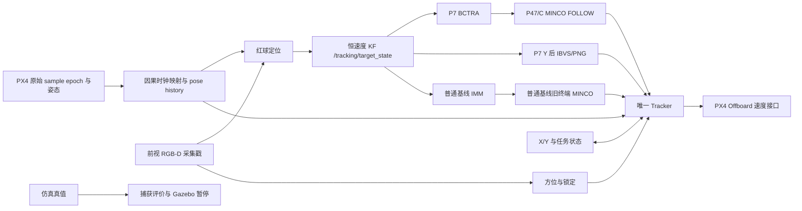

# 当前架构、启动精简与代码审查

后续状态：本报告记录的六项缺陷已在后续任务中修复，并完成唯一一轮变速 S 捕获验证，见[修复与实测](audit_repair_validation_20261018.md)。下文保留首次审查时点的复现与当时结果。

审查基点为 `master` 的 `b3ee89ec4f66ca1acb90ae966d678e8ce02a2228`，随后工作树仅修改启动选择、辅助进程管理、相应测试与当前文档。原始源码清单与修改后清单分别位于 `data/experiments/20261018_architecture_audit_01/source_manifest.json`、`delivery_manifest.json`。本轮没有提交、推送或新增飞行。

## 已完成的启动修改

按[启动说明](startup_profile.md)，P7 两个入口均不启动闲置的 `intercept_planner_node`；FOLLOW 的 `p4_follow_planner_node` 保留。普通基线保留旧终端规划器，算法入口没有切换。真实 launch 条件离线展开的结果是普通基线 11 个节点、P7 直接入口和实验入口各 10 个节点，详见 `resolved_graphs.json`。

QGroundControl 默认不自动打开，已有实例仍可复用；没有实例时由实验进程管理轻量 GCS 心跳，显式 `UAV_USV_START_QGC=true` 可恢复自动打开。已有 P7 驱动提供心跳时不重复启动。测试覆盖正常结束、心跳提前退出、SIGTERM 和关闭终端的 SIGHUP，确保辅助子进程被停止并回收。Gazebo 可视界面与 X/Y 命令台保留。

## 当前架构

P7 的 X 阶段为视觉跟随与 MINCO 接管，Y 撤销 FOLLOW 权限并使用同一 Tracker 执行 IBVS/PNG。普通基线继续使用自己的 IMM 与终端规划流程。两者都通过 `/tracking/target_state` 使用视觉 KF；真值只参与评价、显式 shadow 和离线分析。MPC 尚未实现。红球仍然只验证当前感知接口。

MINCO 的求解成功、proposal、ACCEPTED 与实际 ACTIVE 控制权分别审计。接收端仍有启动时刻、原始输入年龄、父轨迹、boot/mission/generation、0.45 s 租约和本地复核；P7 在 Y 后撤销 FOLLOW。原始导航与姿态年龄、因果 bracket、图像采集戳和 0.50 m 捕获半径均未修改。

## 已确认且尚未修复的缺陷

以下问题均与此次启动修改分开保留；不能把全量测试通过理解为这些边界已经覆盖。优先级 P1 表示应优先修复，P2 表示有明确触发条件的可靠性或统计缺陷。

### 1. [P1] 普通基线终态可被迟到的 Tracker 消息重新激活

位置：[mission_manager.py:203](../../src/uav_control/uav_control/mission/mission_manager.py#L203)、[trajectory_tracker_node.py:1387](../../src/uav_control/uav_control/control/trajectory_tracker_node.py#L1387)。

在已经锁定并接受 Y 的普通基线任务中，通过 ROS 命令 Q 进入 `ABORTED` 后，只要队列中仍有同任务、新鲜的 `PLAN_ACCEPTED`，`observe_tracker()` 没有检查 `completed`，就能把状态改回 `MINCO_READY`。Tracker 接受该状态消息时也忽略 `completed=true`，因而失去终态保护。普通脚本命令台的 Q 当前只关闭控制台，与这里的 ROS Q 中止命令有区别。

真实 core 与 Tracker 回调的离线复现结果：`ABORTED → MINCO_READY`，同时 `completed=true`；手动 `CAPTURE`、`FAILURE` 也存在同一问题。P7 因该回调提前返回，三种终态均保持不变。评价器不调用手动 capture/failure 接口，不能将其描述为现有评价器捕获后已经复飞。

修复建议：完成态锁存；仅显式 R 能重开任务。核心拒绝完成态的 tracker/tick 转移，Tracker 再独立按 `completed` 拒绝接纳，测试覆盖旧队列与同任务乱序。此探针没有证明真实飞行已重新执行轨迹。

### 2. [P1] 普通启动器可能中止不属于本任务的 PX4

位置：[start_px4_ros2.sh:148](../../scripts/start_px4_ros2.sh#L148)。

启动器先在当前 Gazebo partition 查找 live clock，然后按可执行路径查找所有 PX4 并发送 SIGINT，没有核对进程所属 partition、任务清单或启动身份。另一个 partition 的正常 PX4 可能被认作“orphan”。P7 实验驱动的全局 preflight 通常会提前拒绝外部仿真，所以该路径主要暴露在普通启动器。

以所有系统调用均为桩的离线脚本执行真实启动分支，外部假 PID `424242` 被选为 SIGINT 对象。没有向任何真实进程发送信号。

修复建议：仅根据任务持有的 PID、start identity 与会话记录清理；遇到无法证明归属的 PX4 时停止新启动并报告，不能根据“本 partition 无时钟”推断其他进程已失效。

### 3. [P2] KF 未来时间戳可以长期阻塞后续正常图像

位置：[target_kalman_filter.py:209](../../src/uav_control/uav_control/tracking/target_kalman_filter.py#L209)。

measurement callback 只检查单调时间，未在修改状态前拒绝未来时间戳。当前时间 10 s 时注入一帧 stamp=100 s，随后 10.1–11.0 s 的十帧正常观测全部被丢弃；最后输出无效，必须等到时间超过 100 s 或重启才有机会恢复。

上游 localizer 已有时间拒绝，因此这是异常消息、时钟跳变或接口接入时的输入防御缺口，不能据此归因为最近 S 型实验中的真实触发。修复应在 KF 修改前检查时域，保留真实采集戳，不引入经验延迟或放宽 freshness。

### 4. [P2] KF 被拒绝的观测仍会改变滤波状态

位置：[target_kalman_filter.py:224](../../src/uav_control/uav_control/tracking/target_kalman_filter.py#L224)。

callback 先 `predict_to()`，随后 update 才校验协方差的半正定性。负协方差观测虽被拒绝，filter epoch 已从 10.1 推到 10.2 s，状态也已改变；后续 stamp=10.15 s 的有效观测仍被接纳，形成 filter time=10.2、last measurement=10.15 的不一致。

修复建议：在 prediction 前完成观测与协方差验证，或以临时状态完成更新再一次提交。单帧拒绝应保持原状态不变；不需要修改 Q/R。

### 5. [P2] PX4 坐标重置未切断感知 pose history

位置：[rgbd_target_localizer.py:1645](../../src/uav_control/uav_control/perception/rgbd_target_localizer.py#L1645)、姿态回调及 `UavState.msg`。

在线感知 position callback 不消费 `xy_reset_counter` / `z_reset_counter`，姿态回调未消费 quaternion reset generation；当前 UavState 也没有传递空间坐标重置代号。因果时间 bracket 正确不等于同一个空间坐标系。

真实 position callback 接收 40 ms 内从 x=0 到 x=10、reset counter 从 0 到 1 的样本，history 在中点返回 x=5。这是跨坐标跳变生成的虚构 pose，并非真实运动。研究输入模块已有部分 reset 处理，不能据此推断主感知链已覆盖。复现未改变时钟映射，只隔离空间 epoch 问题；没有证明近期实验发生过 EKF reset。

修复需要一个独立的坐标 epoch 契约：切断跨 reset 的位置/姿态插值，并使 KF/预测及已接纳轨迹失效或进行有证明的统一坐标变换。只清一个 buffer 不足以消除整条链的混帧。

### 6. [P2] 制导统计未按捕获结束时刻过滤所有样本

位置：[p7_follow_analysis.py:22](../../scripts/p7_follow_analysis.py#L22)。

`guidance_metrics(stop=...)` 对诊断和物理状态做了截止过滤，但 guidance 总数、图像误差极值等仍使用全部有效 guidance。最新 S 型原始运行中因此记录 293 帧、垂直误差最大 1.923532；严格捕获前窗口实际为 290 帧、最大 1.591220，多出的三帧发生在捕获结果之后。

最新交付已有独立严格窗口复算，捕获距离约 0.498 m 的结论没有因此改变。此处是自动汇总缺陷；`final_distance` 还是末两秒中位数，不能当作捕获瞬时距离。修复应统一所有指标的物理窗口，明确区分窗口统计和事件瞬时值，旧原始证据保持不变。

## 验证与边界

- 最终源码完整 pytest：**2178 passed、2 skipped、3 warnings**，39.86 s；日志 `pytest_delivery.txt`。其中新增启动测试 15 项，保留完整在线输入与唯一发布者检查。两条 warning 来自 ament 插件弃用接口，一条来自 launch 日志目录切换。
- 四个包的 workspace 构建成功；`ros2 pkg prefix uav_control` 指向 `/home/qin/data/uav_usv_mpc/install/uav_control`。
- 项目指定范围 flake8、shell 语法、`git diff --check` 通过。首次 lint 未读到根配置，按默认 79 列产生误报；使用仓库 `.flake8` 的 99 列标准复核通过，没有格式化历史文件。
- 六个问题的复现脚本为 `data/experiments/20261018_architecture_audit_01/reproduce_findings.py`，机器可读结果为 `reproduced_findings.json`。全部使用真实纯核心/回调，或明确标注的系统调用桩；没有启动 ROS 节点、PX4 或 Gazebo。
- 审查覆盖当前入口与参数覆盖、主感知/KF/预测、MINCO 接收/租约、Tracker 与任务边界、捕获评价和启动清理。没有对外部 PX4 二进制、DDS 网络安全或真实硬件做完整安全认证。
- 近场目标整体视锥仍无硬保证，红球部分裁切与有效检测可以同时发生。历史 solver 可行、shadow 回放及历史飞行不能替代本次启动修改后的实际飞行验证。

建议按 1 → 2 → 3/4 → 5 → 6 分成独立修复任务；每项先补触发边界回归，再做最小修改。此次按用户新要求先完成启动精简并继续检查，没有把这些控制/分析修复混在启动改动中。
