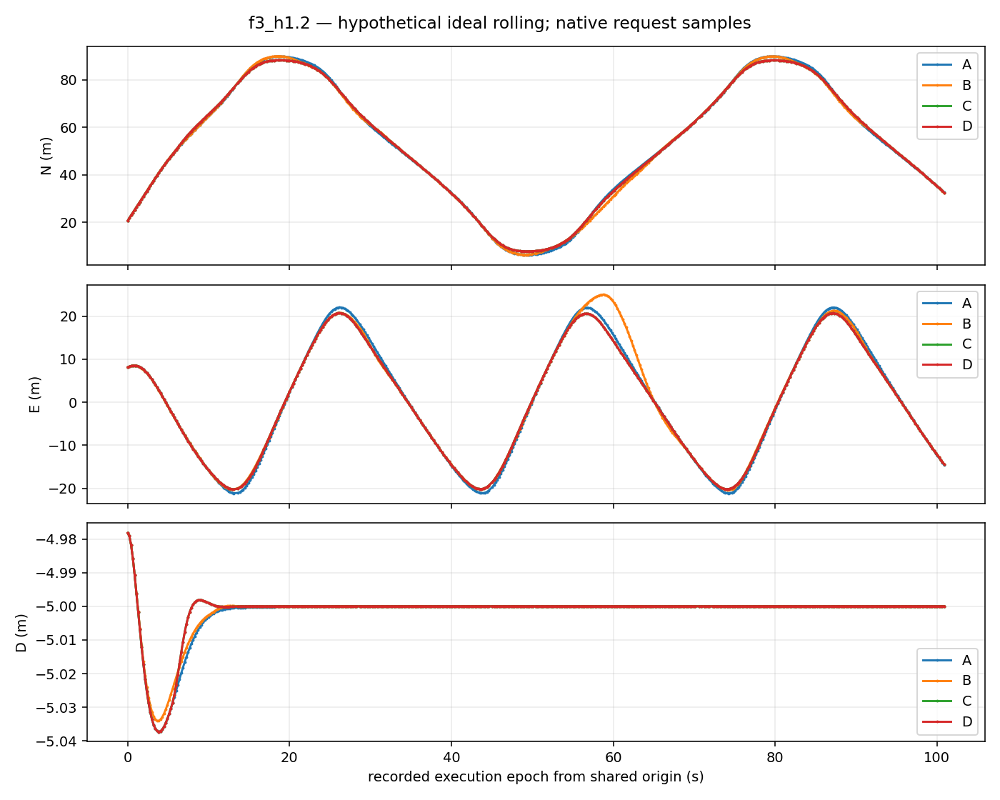
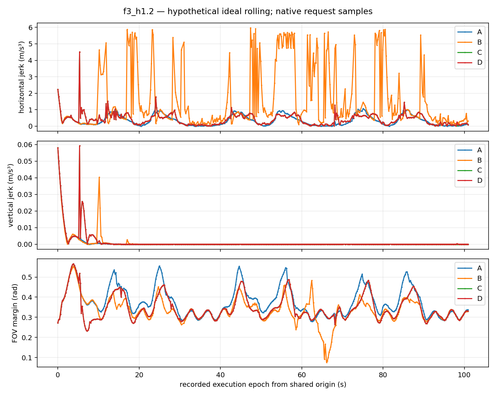
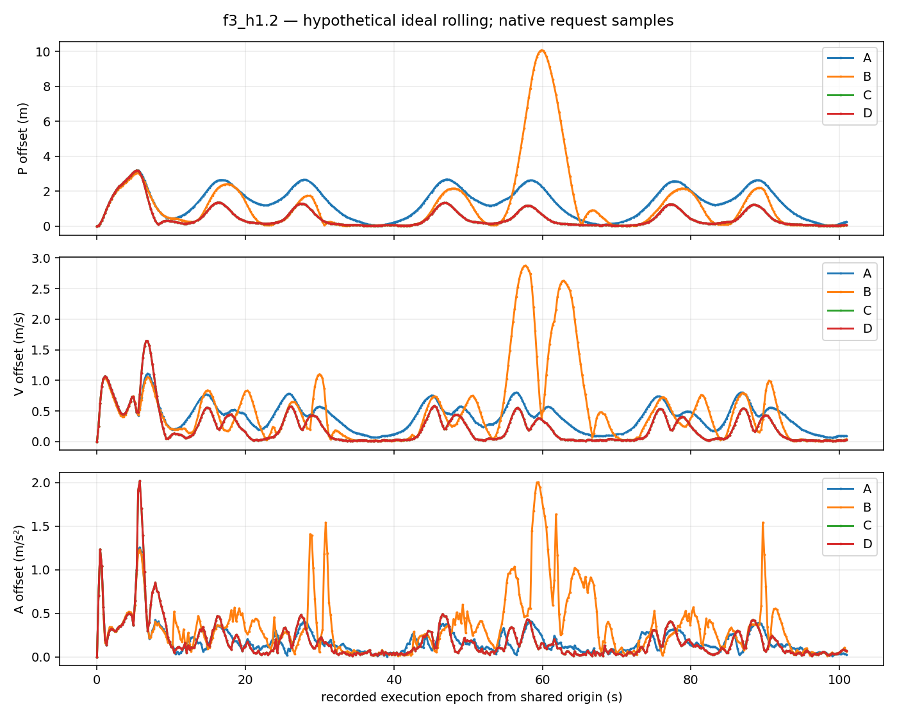
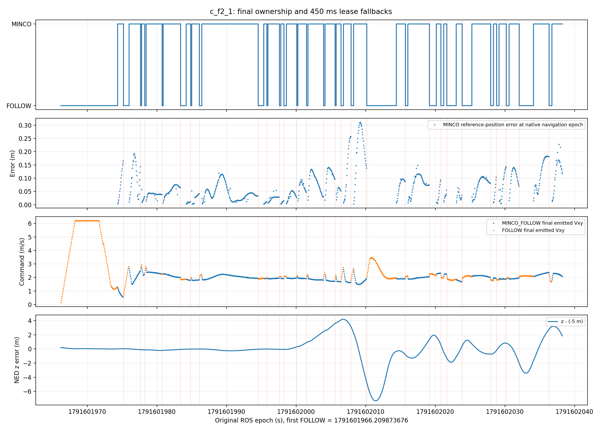
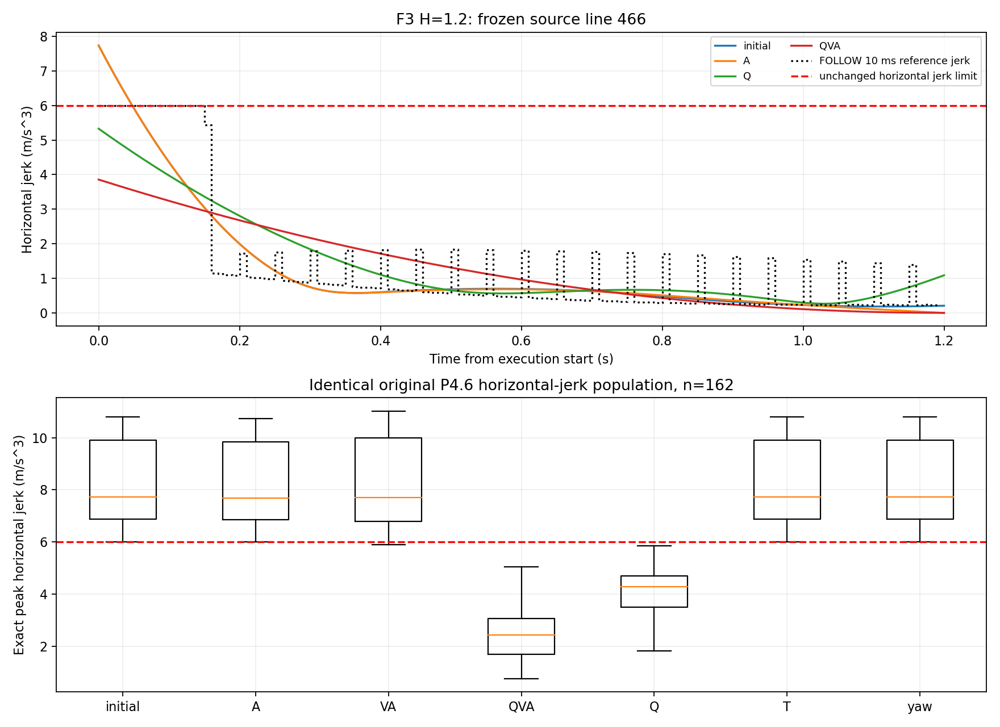

# P4.7：FOLLOW 引导 MINCO 可行性研究

**结论：保留独立研究模式，本轮不替代 P4.4/D、不启动 SITL。** F3/H1.2 最终
可行率恢复至 450/489（92.0%），历史 hJ 解除 155/162，同窗 after20 XY RMSE
降至 .492 m；但 F2/H1.2 从 .089 m 退化至 .188 m，FOV 最小裕度也有下降。
额外低维修正的收益很小、耗时明显增加。正负结果均保留，不能只展示 F3。
结论限于原冻结仿真输入；红球仍只验证感知接口，不能外推真实无标记非合作 USV 的捕获率。

本轮以 P4.4/D 为冻结基线，保留 P4.6 比较实现；新增显式选择的
`p47_follow_guided` 研究 engine。实际执行归因见
[P4.5 执行归因](p47_execution_root_cause.md)，精确导数与终端反事实见
[闭环与导数归因](p47_minco_closed_loop_diagnosis.md)。

## 实现与边界

原 FOLLOW 仍以 20 Hz 调用 `FlightGuidanceCore`，响应积分保留 10 ms。
新增 scalar 路径减少小数组和对象分配；原 `rollout_follow` 函数及原有调用保持。
1214 个冻结请求×H 上，scalar10 与原 NumPy10 的全部 P/V/A/command 数值差为 0，
完整验收状态差为 0。5 ms 产生最多 7.44 mm 位置差和两个 F3 验收变化；20 ms
产生最多 8.85 mm 位置差，虽该数据集状态相同，仍不据此降低积分精度。

终端 P、起始 P/V/A、Accepted parent、yaw 和三段时长固定。三种显式变量域为：
末端 A 分量 ±1.5 m/s²，末端 V 分量 ±0.5 m/s，两个 Q 各分量 ±0.2 m。
这些是相对 FOLLOW 初值的搜索域，不能替代任何物理验收上限。
MINCO 的原线性映射给出系数及变量雅可比；三点 Gauss 对 jerk 二次多项式平方精确积分。

初始化使用有界 jerk 能量二次修正，含微小归一化调整惩罚。完整修正目标仍同时含
FOLLOW P/V、预测 USV 的期望观测 P/V、正确 jerk 积分、完整球目标可见性与动力学
代价、有界调整惩罚。最多四次 SLSQP 迭代、6 ms 优化时限，仅通过原 `validate_seed`
的候选才可保留；可行的边界候选优先保留，完整目标下降本身不代表可行。
每次返回的修正分别记录 `boundary_candidate`、`repair_candidate` 和最终选中候选。

调度同时检查原始输入过期时刻和单调求解时钟；保留原 20 ms 发布/接收余量。
10 ms FOLLOW/10 ms 后备/4 ms 验收是调度估计，不能保证最坏执行时间。
短预算优先原 P4.4/D 后备，不以 25 ms 作为所有请求的统一门槛。
结束前再次检查真实截止；过期时即使此前验收通过，也不能输出 valid。

未修改 BCTRA、相机、USV、PX4、Tracker、名义 lease、125 ms 输入年龄或硬约束。
真值不进入本轮在线计算。新 engine 复用现有研究节点，不增加 PX4 发布者。
原 P4.4/D 与 P4.6 源码按字节保留；旧 jerk 能量报告问题单独标注，未全局修写。

## 首版失败与修正理由

`comparison/formal_20261012_1/` 是完整保留的首版失败消融。其加权二次初始化
把 USV 位置追赶直接混入初值：冻结 F3 第 436 行的 hJ 从 7.0707 增至 54.0910 m/s³，
正确 jerk 能量从 17.3311 增至 213.9110。独立 BVLS 对照和 KKT 残差约 1e-15
排除了该实例的二次求解器数值错误；问题是初始化目标与硬可行性冲突。

首版 F3/H1.2 C/D 最终均为 450/489，独立仅 265/489，20 s 后同窗 XY RMSE
1.474 m，高于 P4.4/D 的 1.351 m；D 单请求 P95 18.785 ms。这个版本没有被隐藏。
新一轮 `formal_20261012_2/` 只改为先做有界 jerk 初值，再尝试完整目标修正，
并修复修正元数据被最终候选覆盖的问题。全部正式数据重新写入独立子目录。

## 数据与比较口径

A 为原 P4.4/D；B 为原 P4.6 fixed；C 为 P4.7 QVA 边界固定；D 为同一 QVA
加有界低维完整目标修正。A/VA/QVA 及 legacy/adaptive 调度另作单独消融。
主组 QVA 在阶段 B 的反事实分析后、正式比较前确定。

每个 H 使用相同原始请求、BCTRA、起始 PVA/epoch、相机、完整目标半径、约束
指纹及输入期限。F2 single=118，真实间隔中位约 1.020 s；F3 single=489，约 .218 s。
不补造 F2 的 5 Hz 请求。理想滚动复用 P4.6 的连续 own-curve 单 episode 策略，
共同初始化后 F2=106、F3=470 个实际选中 epoch，首个未覆盖时刻即停止，不重新起跑。

连续覆盖与本次新 proposal 的可行率分别计算：拒绝新候选时，未过期的前条曲线
仍可维持覆盖。所有跨方法 RMSE 都取相同 source 行 hash 与 epoch 交集。
四组 after20 交集为空时明确为空；另外报告 A/C/D 同窗，不能拿各自有利窗口拼表。
这些全部是预测模型中的理想滚动，不是实测 UAV/PX4 的闭环效果。

## 单请求可行率与耗时

分母包含所有原始请求，不能排除短预算或不合法起点。后备触发数与后备成功数分别列出。
耗时是本次 fresh replay 的包含 profile 开销的外层实测 wall time；不与历史不同运行的耗时作百分比比较。

| 场景 | H | 组 | 独立通过 / N | 最终通过 / N | 最终率 % | 后备触发 / 成功 |
|---|---|---|---|---|---|---|
| F2 | 1.2 | A | 109/118 | 109/118 | 92.37 | 0/0 |
| F2 | 1.2 | B | 83/118 | 85/118 | 72.03 | 7/2 |
| F2 | 1.2 | C | 87/118 | 109/118 | 92.37 | 31/22 |
| F2 | 1.2 | D | 87/118 | 109/118 | 92.37 | 31/22 |
| F2 | 1.6 | A | 109/118 | 109/118 | 92.37 | 0/0 |
| F2 | 1.6 | B | 83/118 | 85/118 | 72.03 | 6/2 |
| F2 | 1.6 | C | 87/118 | 109/118 | 92.37 | 31/22 |
| F2 | 1.6 | D | 87/118 | 109/118 | 92.37 | 31/22 |
| F3 | 1.2 | A | 450/489 | 450/489 | 92.02 | 0/0 |
| F3 | 1.2 | B | 259/489 | 396/489 | 80.98 | 158/137 |
| F3 | 1.2 | C | 299/489 | 450/489 | 92.02 | 187/151 |
| F3 | 1.2 | D | 299/489 | 450/489 | 92.02 | 187/151 |
| F3 | 1.6 | A | 450/489 | 450/489 | 92.02 | 0/0 |
| F3 | 1.6 | B | 297/489 | 397/489 | 81.19 | 121/100 |
| F3 | 1.6 | C | 323/489 | 450/489 | 92.02 | 163/127 |
| F3 | 1.6 | D | 323/489 | 450/489 | 92.02 | 163/127 |

| 场景 | H | 组 | 初始化 P50/P95 ms | 总求解 P50 ms | P95 ms | P99 ms |
|---|---|---|---|---|---|---|
| F2 | 1.2 | A | —/— | 4.935 | 5.544 | 9.442 |
| F2 | 1.2 | B | 4.911/5.035 | 9.121 | 11.327 | 11.874 |
| F2 | 1.2 | C | 1.517/1.634 | 6.532 | 9.271 | 9.458 |
| F2 | 1.2 | D | 1.506/1.587 | 12.984 | 15.567 | 16.051 |
| F2 | 1.6 | A | —/— | 5.740 | 6.436 | 9.361 |
| F2 | 1.6 | B | 6.435/6.846 | 11.165 | 13.434 | 14.799 |
| F2 | 1.6 | C | 1.752/1.823 | 7.336 | 9.771 | 10.391 |
| F2 | 1.6 | D | 1.744/1.819 | 13.458 | 18.703 | 18.792 |
| F3 | 1.2 | A | —/— | 6.535 | 9.950 | 11.474 |
| F3 | 1.2 | B | 5.411/5.988 | 10.236 | 15.303 | 16.177 |
| F3 | 1.2 | C | 1.791/1.969 | 7.974 | 13.045 | 14.014 |
| F3 | 1.2 | D | 1.783/1.944 | 13.728 | 16.816 | 17.358 |
| F3 | 1.6 | A | —/— | 6.175 | 9.140 | 10.368 |
| F3 | 1.6 | B | 6.936/7.234 | 12.283 | 17.245 | 18.827 |
| F3 | 1.6 | C | 1.837/1.998 | 7.881 | 12.633 | 14.368 |
| F3 | 1.6 | D | 1.866/2.034 | 13.906 | 16.784 | 17.474 |

A 的初始化未按 FOLLOW 单独记录，故显示未知。B/C/D 包含未尝试请求的 0，不能把它们当作一次成功初始化的成本。
独立 rollout 性能包另给纯滚动耗时：F3/H1.2 P50 4.225→0.599 ms、P95 4.452→0.654 ms；
H1.6 P50 5.388→0.751 ms。完整初始化、MINCO 构造和严格验收仍有成本。

## 拒绝原因与历史 jerk 人口

下面是 F3 的独立方法阶段拒绝分类，可重叠；不等于所有同时存在的物理违约。
原验证器只返回泛 DYNAMIC 时，必须有精确导数证据才细分；A 的此类拒绝保留 unresolved。
预算/时效列包含对应状态码；P47 的 22 个 `SHORT_BUDGET_P44_PRIORITY` 是主动转后备，单独列明。

| H | 组 | jerk | speed | accel | yaw | 预算/时效 | dynamic 未细分 | 其他 |
|---|---|---|---|---|---|---|---|---|
| 1.2 | A | 0 | 0 | 0 | 1 | 3 | 35 | 0 |
| 1.2 | B | 162 | 26 | 4 | 29 | 33 | 0 | 0 |
| 1.2 | C | 7 | 33 | 4 | 128 | 3 | 0 | 22 |
| 1.2 | D | 7 | 33 | 4 | 128 | 3 | 0 | 22 |
| 1.6 | A | 0 | 0 | 0 | 1 | 3 | 35 | 0 |
| 1.6 | B | 112 | 26 | 4 | 32 | 33 | 0 | 0 |
| 1.6 | C | 2 | 33 | 4 | 104 | 3 | 0 | 22 |
| 1.6 | D | 2 | 33 | 4 | 104 | 3 | 0 | 22 |

F3/H1.2 最终失败仍为 39：35 个原后备 DYNAMIC、1 个 yaw、3 个时效。
初值还未尝试就转后备的 22 条计入独立方法未成功，不能冒称 jerk 修复或额外输入。

| H | 历史 hJ 人口 | QVA 解除 hJ | 完整独立通过 | 含后备最终通过 |
|---|---|---|---|---|
| 1.2 | 162 | 155 | 38 | 135 |
| 1.6 | 112 | 110 | 24 | 94 |

155/162（95.7%）解除 hJ，不等于 155 条全部可执行：该人口同时存在 yaw、速度和起点不可行。
第 436 行新版能量为 9.0047，hJ 为 6.1240，仍超过原 6.0 上限并被拒；能量降低不能替代峰值验收。

## 终端与预算消融

| 场景 | H | 变量 | 独立通过 | 最终通过 | 后备触发 | P95 ms |
|---|---|---|---|---|---|---|
| F2 | 1.2 | A | 85 | 109 | 33 | 15.569 |
| F2 | 1.2 | VA | 85 | 109 | 33 | 15.859 |
| F2 | 1.2 | QVA | 87 | 109 | 31 | 16.108 |
| F2 | 1.6 | A | 86 | 109 | 32 | 15.738 |
| F2 | 1.6 | VA | 86 | 109 | 32 | 16.398 |
| F2 | 1.6 | QVA | 87 | 109 | 31 | 18.424 |
| F3 | 1.2 | A | 268 | 450 | 218 | 19.438 |
| F3 | 1.2 | VA | 264 | 450 | 222 | 18.895 |
| F3 | 1.2 | QVA | 299 | 450 | 187 | 16.325 |
| F3 | 1.6 | A | 309 | 449 | 177 | 19.074 |
| F3 | 1.6 | VA | 302 | 450 | 184 | 19.926 |
| F3 | 1.6 | QVA | 323 | 450 | 163 | 16.851 |

A/VA/QVA 消融均开启同一有界完整目标修正，和主组 C 的关闭修正另作区分。
最终率被后备托住时，A/VA 的不足会被掩盖：H1.6 理想滚动 A/VA 不能完整覆盖，QVA 可以。
阶段 B 同一历史人口的单变量反事实表是判断 Q 必要性的主要依据。

| 场景 | H | 调度 | 独立通过 | 最终通过 | 后备触发 / 成功 | 滚动覆盖 s |
|---|---|---|---|---|---|---|
| F2 | 1.2 | legacy | 85 | 85 | 4/0 | 10.260 |
| F2 | 1.2 | adaptive | 87 | 109 | 31/22 | 106.244 |
| F2 | 1.6 | legacy | 85 | 85 | 4/0 | 10.660 |
| F2 | 1.6 | adaptive | 87 | 109 | 31/22 | 106.244 |
| F3 | 1.2 | legacy | 297 | 418 | 142/121 | 100.899 |
| F3 | 1.2 | adaptive | 299 | 450 | 187/151 | 100.899 |
| F3 | 1.6 | legacy | 321 | 419 | 119/98 | 100.899 |
| F3 | 1.6 | adaptive | 323 | 450 | 163/127 | 100.899 |

压力消融只延迟求解器到达时刻，原输入、expiry 和 20 ms reserve 不变；旧门槛八组均 0 通过。

| 场景 | H | N | adaptive 8 ms | 12 ms | 20 ms | 24 ms |
|---|---|---|---|---|---|---|
| F2 | 1.2 | 118 | 109 | 109 | 109 | 109 |
| F2 | 1.6 | 118 | 108 | 109 | 109 | 109 |
| F3 | 1.2 | 489 | 377 | 450 | 450 | 450 |
| F3 | 1.6 | 489 | 399 | 450 | 450 | 449 |

8 ms 等紧预算仍会出现真实超期，24 ms/H1.6 也有一次失败；经验 P95/P99 不是保证。

## 连续理想滚动：覆盖与同窗误差

| 场景 | H | 组 | 新 proposal 通过 / N | 连续覆盖 s | 完整覆盖 | 后备成功 |
|---|---|---|---|---|---|---|
| F2 | 1.2 | A | 106/106 | 106.244 | 是 | 0 |
| F2 | 1.2 | B | 10/106 | 10.260 | 否 | 0 |
| F2 | 1.2 | C | 106/106 | 106.244 | 是 | 21 |
| F2 | 1.2 | D | 106/106 | 106.244 | 是 | 21 |
| F2 | 1.6 | A | 106/106 | 106.244 | 是 | 0 |
| F2 | 1.6 | B | 10/106 | 10.660 | 否 | 0 |
| F2 | 1.6 | C | 106/106 | 106.244 | 是 | 19 |
| F2 | 1.6 | D | 106/106 | 106.244 | 是 | 19 |
| F3 | 1.2 | A | 468/470 | 100.899 | 是 | 0 |
| F3 | 1.2 | B | 404/470 | 100.899 | 是 | 151 |
| F3 | 1.2 | C | 468/470 | 100.899 | 是 | 47 |
| F3 | 1.2 | D | 468/470 | 100.899 | 是 | 47 |
| F3 | 1.6 | A | 461/470 | 100.899 | 是 | 0 |
| F3 | 1.6 | B | 8/470 | 3.759 | 否 | 8 |
| F3 | 1.6 | C | 464/470 | 100.899 | 是 | 34 |
| F3 | 1.6 | D | 464/470 | 100.899 | 是 | 34 |

四组共同 after20 仅 F3/H1.2 非空（N=376）；该窗口 A/B/C/D XY RMSE 分别为
1.351444/2.359128/0.492282/0.492271 m。
F2 两个 H 与 F3/H1.6 的四组共同 after20 均为空，不能比较各自不同窗口。以下另列 A/C/D 完整同窗。

| 场景 | H | 组 | 全程 XY RMSE m | after20 XY m | after20 相对 V m/s | after20 Z m |
|---|---|---|---|---|---|---|
| F2 | 1.2 | A | 0.085255 | 0.089260 | 0.067121 | 0.00000004 |
| F2 | 1.2 | C | 0.170444 | 0.187594 | 0.218651 | 0.00221926 |
| F2 | 1.2 | D | 0.170444 | 0.187594 | 0.218651 | 0.00221926 |
| F2 | 1.6 | A | 0.084030 | 0.088567 | 0.063937 | 0.00000002 |
| F2 | 1.6 | C | 0.064056 | 0.065157 | 0.085164 | 0.00000000 |
| F2 | 1.6 | D | 0.064153 | 0.065274 | 0.085142 | 0.00000347 |
| F3 | 1.2 | A | 2.730884 | 1.351444 | 0.417476 | 0.00000767 |
| F3 | 1.2 | C | 2.433676 | 0.492282 | 0.415844 | 0.00000002 |
| F3 | 1.2 | D | 2.433675 | 0.492271 | 0.415848 | 0.00000052 |
| F3 | 1.6 | A | 2.565505 | 0.504651 | 0.438126 | 0.00002532 |
| F3 | 1.6 | C | 2.545231 | 0.431856 | 0.397000 | 0.00000017 |
| F3 | 1.6 | D | 2.545214 | 0.431732 | 0.397108 | 0.00000377 |

F2 同窗 N=106/after20=86，F3 为 470/376。F2/H1.2 C/D 的稳态 XY 由 .0893 增至 .1876 m，
相对速度由 .0671 增至 .2187 m/s；这是本轮未通过 SITL 门槛的明确退化，不能只展示 F3 的改善。
有界最小能量初值在直线场景改变了已较好的 FOLLOW 局部响应；目前证据支持这一质量取舍，尚无植物反事实证明。

## 动力学、完整目标 FOV 与边界

下表为完整理想滚动中所有最终验收通过曲线的独立精确导数最大值，含成功后备；
FOV 是原完整目标验收的最小裕度，非目标中心点可见性。各组被接受曲线人口可以不同。

| 场景 | H | 组 | hV ≤6.2 | vV ≤4 | hA ≤3 | vA ≤3 | hJ ≤6 | vJ ≤4 | min FOV rad |
|---|---|---|---|---|---|---|---|---|---|
| F2 | 1.2 | A | 4.233753 | 0.001940 | 0.491628 | 0.001612 | 0.727172 | 0.000965 | 0.187957 |
| F2 | 1.2 | C | 4.802348 | 0.014145 | 1.574542 | 0.023675 | 3.256144 | 0.100812 | 0.005641 |
| F2 | 1.2 | D | 4.802348 | 0.014145 | 1.574542 | 0.023675 | 3.256144 | 0.100812 | 0.005641 |
| F2 | 1.6 | A | 4.354332 | 0.001940 | 0.524272 | 0.001612 | 0.503944 | 0.000880 | 0.179966 |
| F2 | 1.6 | C | 4.932323 | 0.001940 | 1.181675 | 0.001750 | 4.475437 | 0.003648 | 0.144091 |
| F2 | 1.6 | D | 4.932323 | 0.001940 | 1.181675 | 0.001750 | 4.475438 | 0.003648 | 0.144091 |
| F3 | 1.2 | A | 5.925037 | 0.025578 | 2.585440 | 0.049768 | 2.228346 | 0.057941 | 0.271070 |
| F3 | 1.2 | C | 6.074080 | 0.031454 | 2.504594 | 0.049768 | 4.512887 | 0.059164 | 0.231541 |
| F3 | 1.2 | D | 6.074080 | 0.031454 | 2.504594 | 0.049768 | 4.512887 | 0.059164 | 0.231541 |
| F3 | 1.6 | A | 6.195869 | 0.049454 | 2.184979 | 0.060369 | 1.039073 | 0.045517 | 0.244435 |
| F3 | 1.6 | C | 6.195436 | 0.150067 | 2.123665 | 0.140440 | 2.393306 | 0.217760 | 0.211336 |
| F3 | 1.6 | D | 6.195436 | 0.150067 | 2.123665 | 0.140440 | 2.393306 | 0.217760 | 0.211336 |

yaw/姿态/推力/海面仍走原完整验收。F3/H1.2 C 的最大 yaw rate .9634 rad/s、tilt .2505 rad、
specific thrust 10.1023 m/s²；所有通过曲线保持原门槛。**标准未放宽，但实际 FOV 最小裕度下降**：
同场景 A 为 .2711 rad，C/D 为 .2315 rad，不能声称 FOV 裕度完全没有损失。

| 场景 | H | 组 | P 偏差 P50/P95 m | V 偏差 P50/P95 m/s | A 偏差 P50/P95 m/s² |
|---|---|---|---|---|---|
| F2 | 1.2 | C | 0.065433/0.390446 | 0.058645/0.314160 | 0.193696/0.696106 |
| F2 | 1.2 | D | 0.065433/0.390446 | 0.058645/0.314160 | 0.193696/0.696106 |
| F2 | 1.6 | C | 0.043329/0.132835 | 0.033438/0.123063 | 0.066223/0.256273 |
| F2 | 1.6 | D | 0.043553/0.132835 | 0.034520/0.123064 | 0.066969/0.256273 |
| F3 | 1.2 | C | 0.241270/1.502701 | 0.127044/0.650952 | 0.109464/0.487368 |
| F3 | 1.2 | D | 0.241270/1.502701 | 0.127044/0.650952 | 0.109464/0.487368 |
| F3 | 1.6 | C | 0.283666/1.749046 | 0.134847/0.838322 | 0.094295/0.650451 |
| F3 | 1.6 | D | 0.283666/1.749046 | 0.134847/0.838322 | 0.094314/0.650451 |

该偏差比较理想 own-curve 边界与同一请求所保存导航 PVA 的显式 CA 投影，不能叫作真实跟踪误差。
原始 measurement 与 projected_measurement 两套数值均保留。全部 C/D 交接的 P/V/A/yaw/rate
参考间误差为 0；这与实测 PVA 偏差并不矛盾，植物证据仍以阶段 A 同 native epoch 分解为准。

## 修正收益与剩余算法问题

D 没有新增独立通过数量。F3/H1.2 single 的 334 次优化中，333 次到达 6 ms 有界停止，
仅 1 次返回并通过验收；rolling 442 次中也仅 1 次返回。H1.6 rolling 437 次中返回并保留 23 次，
XY RMSE 仅 .431856→.431732 m；P95 却 10.698→19.600 ms。因此 D 的完整目标修正目前不值得默认启用。
C 比 B 改善了可行率和 F3 长期误差，但单请求仍有 38.2%（H1.2）/33.3%（H1.6）触发后备。
F3/H1.2 rolling 后备降至 47/470，不能外推为实际 ACTIVE 比例。
剩余方向是固定 yaw/合法起点之外的联合约束质量，以及在降低 jerk 时保留已良好的直线 FOLLOW 响应；
本轮不新增 yaw/T 贪心搜索，不盲调权重，不延长名义 lease，也不以更宽约束掩盖负结果。

## 阶段 E：五项门禁与实际 SITL

| 门禁 | 判断 | 当前证据与限制 |
|---|---|---|
| 1 冻结输入最终可行率足够 | 通过 | F2 109/118、F3 450/489，两个 H 一致；独立率与后备另列 |
| 2 长期理想滚动无明显退化 | **未通过** | F2/H1.2 XY 约 2.10 倍、相对速度约 3.26 倍；F3 改善不能覆盖此反例 |
| 3 计算与 125 ms 余量合理 | 仅支持有界 C 研究 | C 的 F3/H1.2 P95 13.045 ms，结束最少仍有 .844 ms 计算余量加原 20 ms 发布预留；不是实测 receiver 全周期保证 |
| 4 执行问题可信归因且有受控方案 | 归因及方案具备，植物修复未验证 | 阶段 A 的参考高度/lease 机制；准备一次 F2、实际观察 FOLLOW 后 25 s、发现高度偏差 >1 m 或状态异常即停止的方案 |
| 5 隔离与名义执行门禁 | 静态和只读预检通过 | 原隔离门禁测试未退化；没有外部仿真、串口设备，8888 端口空闲、可用域 43；未签发实际运行 grant |

因此 **本轮实际 SITL 次数为 0**。未创建本任务 `sitl_attempt.json`，没有启动
PX4/Gazebo，没有终止其他会话。`scripts/p47_minco_sitl.py` 仅是经过三项测试的
受控准备工具：五项布尔门禁必须全部通过、持久独占 claim 限制最多一次，复用原
任务进程身份清理与 runtime grant。当前 `qualification.json` 的第二项为 false，
它不能启动本轮验证。额外高度停止界限是实验终止条件，不是控制约束的放宽。

没有 P4.7 实测 ACTIVE 占比、首次接管时间、实际高度/水平 RMSE、PX4 接收余量或
在线完整周期，不能从离线数据补造。P4.5 的实测数据仍只用于阶段 A 归因。

## 最终十五项回答

1. **P4.5 高度误差**：H1.6 主要是 MINCO 参考偏离 -5 m，ACTIVE 参考高度 RMSE
   1.516/.523 m，实测对参考仅 .053/.059 m；全 owner 高度 2.246/1.091 m 还包含回退恶化。
   XY-only rank、XYZ jerk 缩放与 parent 垂向 PVA 继承是有时序支持的生产者机制。
2. **频繁回退**：131 次直接原因都是 .45 s lease 到期。上游 116 次没有及时接替 proposal、
   9 次接替被拒、6 次 accepted 接替 START_MISSED；没有 active REVOKED。
3. **连续性与实测误差**：Accepted 的参考 PVA 连续只保证两条曲线衔接，不等于真实 UAV
   状态重合；也不保证参考高度正确或下一次 lease 之前必有接替。
4. **P4.6 jerk 来源**：历史 H1.2 的 162 个 hJ 峰值全部在第一段，155 个 t=0；
   起点与早段 Q 的兼容性关键。32 个全人口请求起始 V/A 已非法，且 yaw 常同时超限。
5. **终端 V/A 放松**：单独 A/VA 在历史 162 人口仅解除 1/4 个 hJ；不能独立解决主要问题。
6. **是否需要 Q**：需要。Q-only 解除 151/162，QVA 155/162；H1.6 为 100/112 与 110/112。
7. **初始化是否提速**：是。保留 10 ms 精度，纯 rollout F3/H1.2 P50 4.225→.599 ms；
   完整初始化 P50 5.411→1.791 ms。完整求解仍包含系数构造和严格几何验收。
8. **是否大量依赖后备**：单请求仍是：H1.2 187/489、H1.6 163/489 次触发。理想滚动
   降到 47/470、38/470；不能拿后者宣称单请求独立率或实际 ACTIVE 已改善。
9. **F3 最终率是否恢复**：是，两个 H 均 450/489（92.0%）；独立仅 299/489、323/489。
10. **H1.2/H1.6 哪个更好**：当前 C 的 F3/H1.6 独立通过更多、同窗 XY .432 m 优于
    H1.2 .492 m，F2/H1.6 也改善；但 P4.5 的真实 H1.6 高度问题不能靠理想模型宣告解决。
11. **长期水平误差**：F3 两种 H 改善，F2/H1.6 改善；F2/H1.2 明显退化，因此没有全面胜出。
12. **FOV/动力学是否保留**：硬限值及完整目标验收全部保留；实际最小 FOV 裕度有下降，
    F3/H1.2 .271→.232 rad。不能把“门槛没放宽”说成“裕度没损失”。
13. **SITL 是否满足条件**：否，第二门未过，本轮不运行。
14. **实际高度/连续 ACTIVE 是否改善**：没有新实测证据，不能回答为已改善。
15. **能否替代 P4.4/D**：目前不能。F2/H1.2 反例、独立率与后备依赖、D 的耗时收益比
    和尚未验证的植物闭环都阻止默认替换；保留 C/D 独立研究选择及 P4.4/D 原基线。

## 图、日志与复算索引

正式矩阵：`data/experiments/20261010_p47_follow_guided/comparison/formal_20261012_2/`。
其中 104 配置、208 份逐请求结果/分析 JSONL、16 张 PNG，合计 227 个 SHA256 条目。
各原始结果含 raw_request、实际求解 request、完整模型参数、约束指纹、完整结果、
独立与后备状态；分析文件含精确导数、正确/旧报告能量和所有已返回修正候选。

| 索引 | 内容 |
|---|---|
| `manifest.json` | 原始输入路径、源行/行 hash、共同初始化、时效、积分步长、源码 SHA、Git 状态 |
| `summary.json` | 全部消融、拒绝、分位数、覆盖、边界、FOV 与同窗指标 |
| `final_evidence_20261012/` | 历史 jerk 人口见证、首版/新版第436行、修正返回/停止分布、A/C/D 同窗与源码快照 |
| `execution_physical/revision_02/` | P4.5 同 native epoch 实测分解、ULog 对照、派生 shaping 与参考高度机制 |
| `execution_timeline/` | 每轮 switches CSV/JSON、prefix/parent/lease 原时钟时间线、回退 PNG |
| `derivative_diagnosis/` | 历史 162/112 人口、单变量反事实、边界 PVA/jerk 图及脚本快照 |
| `rollout_performance/full_matrix_01/` | 原 NumPy10/scalar5/10/20 的 4856 行性能和数值差证据 |
| `verification_20261012/` | 构建、完整 pytest、flake8、消息/launch/shell、来源和 SHA 核验日志 |

以下图的连线仅连接原记录 epoch，不表示插入新规划请求；都是理想轨迹。更完整的
两个场景×两个 H 的 trajectory/jerk/boundary/timing PNG 在正式矩阵的 `plots/`。











从各包所属目录执行 `sha256sum -c SHA256SUMS`。原始输入 63 个去重文件再次匹配，
冻结基线 46 条、新 timeline 35 条、physical revision_02 42 条、导数诊断 19 条、
rollout 5 条、两个正式矩阵各 227 条全部通过。计数只表示 manifest 列出的条目。

复算使用当前源码并指定**不存在的新目录**，例如：

```bash
cd /home/qin/data/uav_usv_mpc
set -eo pipefail
source /opt/ros/humble/setup.bash
source /home/qin/data/uav_usv_mpc/install/setup.bash
python3 scripts/p47_follow_study.py --output \
  data/experiments/20261010_p47_follow_guided/comparison/reproduce_NEW_ID
```

正式矩阵结束时 173 个源码 hash 与开始一致，快照按仓库相对路径保存。随后只修正
文档字符串与排版，三个变动文件去除 docstring 后的 AST 与矩阵快照一致，证明
算法/分析执行逻辑没变；不能将旧 SHA 强称为当前字节 SHA。见 source_and_boundary_checks。
首版源码在执行期间外部产生的 `741000c` 及首版 manifest 可索引，当前正式版使用
`741000c` 加工作树 hash。起始 HEAD 为 `353c3e1`。本任务没有自动 commit/push。

## 修改文件与验证

| 文件 | 变更 |
|---|---|
| `src/uav_control/uav_control/guidance/follow_rollout.py` | 末尾新增 opt-in scalar 路径，原模块字节前缀保留 |
| `src/uav_control/uav_control/guidance/follow_terminal_correction.py` | 新增 A/VA/QVA 系数映射、jerk 二次初值、完整目标及有界修正 |
| `src/uav_control/uav_control/controllers/follow_guided_feasible.py` | 新增独立 P47 engine、余量调度、严格验收与 P44/D 后备 |
| `src/uav_control/uav_control/controllers/follow_research_shadow_node.py` | 最小显式 engine/参数注册，默认配置未切换 |
| `scripts/p47_physical_diagnosis.py` | 实际同刻误差与生产者机制审计 |
| `scripts/p47_execution_timeline.py` | lease/ACK/owner 逐事件归因 |
| `scripts/p47_derivative_diagnosis.py` | 精确导数、历史人口和单变量反事实 |
| `scripts/p47_rollout_performance.py` | 原实现与 5/10/20 ms 数值、性能对照 |
| `scripts/p47_follow_study.py` | 冻结矩阵、独立候选分析和严格同窗报告 |
| `scripts/p47_minco_sitl.py` | 五门及单次 claim 的受控准备工具，本轮未执行 |
| `src/uav_control/test/test_p47_{physical_diagnosis,execution_timeline,derivative_diagnosis,follow_rollout_fast,terminal_correction,follow_guided_solver,follow_study,sitl_plan}.py` | 8 个测试文件，新增有界性、连续性、元数据、截止、真值拒绝、海面/FOV/parent 与回归测试 |
| `docs/current/p47_execution_root_cause.md`、`p47_minco_closed_loop_diagnosis.md`、本文件 | 三份本轮报告 |
| `docs/current/README.md`、`architecture.md`、`docs/superpowers/plans/2026-10-12-p47-follow-feasibility.md` | 当前索引、研究边界与实施决策记录 |

完整 pytest 从 `src/uav_control` 实跑：**1568 passed、1 skipped**，3 条环境/弃用 warning。
四包 `px4_msgs uav_usv_interfaces uav_control uav_usv_bringup` 构建通过。全范围 flake8、
5 份 shell 的 `bash -n`、3 个 FOLLOW 消息、launch `--show-args`、diff/cached diff
共 12 项静态检查通过，包前缀为 `/home/qin/data/uav_usv_mpc/install/uav_control`。
初轮 style/docstring 失败与修正后的完整日志分别保留，没有只复用上一轮测试计数。

独立审查指出修正候选元数据覆盖问题，已用失败测试→修复→通过验证。审查代理在
完整终稿通读前因额度结束，不能宣称已经完成完整独立终审；本地回归和数据复核已完成。
没有 staging、commit、push；旧仓库、冻结证据、BCTRA/感知/Tracker/运行配置和 PX4
补丁未被本任务修改。完整逐文件路径及当前 SHA 另存 `final_evidence_20261012/changed_files.tsv`。
下一轮应先解决 F2/H1.2 的质量取舍，再按五门决定是否进行实测。
