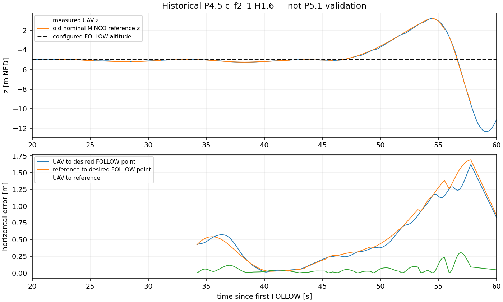
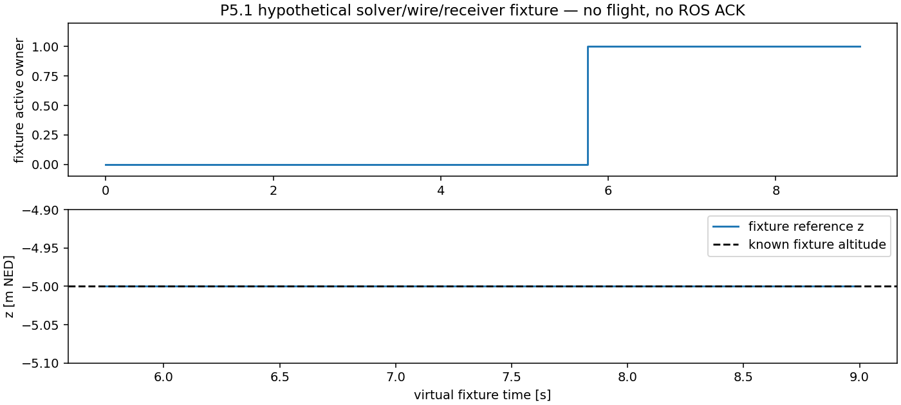

# P5.1 闭环验证与交付

**当前结论：代码、离线与静态验证阶段；本轮未启动 Gazebo，F2/F3 均未执行。**
不能宣称 MINCO 已实际持续接管、历史切换已在飞行中解决，或优于原 FOLLOW。

起点 HEAD 为 `51007415a87d839f8b18ebe6e78c5b4418856ee6`，master。
没有自动 commit/push、切分支或改旧仓库。冻结基线、全部旧实验日志按指纹核验。
新原始产物仅写 `data/experiments/20261012_p51_offline_01/`，完整日志默认忽略；
轻量交付索引位于 `docs/current/audit/p51_follow_minco/`。

## 实现与证据边界

| 项目 | 当前证据 |
|---|---|
| 原 FOLLOW 快速接近 | 控制律未改；大误差被门禁拒绝；本轮实际接近耗时待 F2 |
| 共同 epoch 稳态进入 | 单测与旧 P5 反例；新门禁拒绝 8.255m/4.525m/s 过早启动 |
| Receiver 单一准入、恢复和探测 | 单测、实际节点回调测试、Planner 发布路径测试 |
| 正常接替 / 单次求解失败保留旧 lease | 真实 P47→wire→Receiver 的假设场景离线回放 |
| 到期、非法 parent、START_MISSED、前缀失效、Offboard、时钟回退 | 故障注入，无过期 ACTIVE |
| 新预测、FOV、动力学、输入时效、伪造 ACK、命令整形 | 原回归及新增边界测试 |
| MINCO 参考高度与 parent PVA | 已知共同运动几何的离线回放；不等于飞行跟踪精度 |
| 实际连续接管、占比、原 FOLLOW 对照收益 | 尚无本轮 SITL 证据 |

本轮故障回放明确标记 hypothetical_only，并使用零时长求解时钟隔离协议行为，实际计算
耗时单独记录。该输出不能当成真机/仿真 ACK 或用于 F3 准入。

## 源码修改

- `guidance/follow_admission.py`：共同 epoch 几何与接收器资格。
- `guidance/follow_minco_execution.py`：执行准入、探测、激活 parent 复查、完整 ACK 队列。
- `control/trajectory_tracker_node.py`：本地历史、唯一权威状态、重验及切换诊断。
- `controllers/p4_follow_planner_node.py`：准入消费、真实 ACK/parent 核验、一次有界接替重试、时序。
- `controllers/follow_mpc_shadow_node.py`、`follow_research_shadow_node.py`：worker 时序钩子与显式预算选项。
- `controllers/follow_guided_feasible.py`：目标无关系数预热和阶段预算估计；P47 数学模型不变。
- `FollowReceiverState.msg`：接收器只读资格/owner 心跳扩展。
- `scripts/p5_live_health.py`、`p5_minco_sitl.py`：共享几何、KF 记录、可复用有界 harness。
- `scripts/p4_shadow_monitor.py`：接收时序与每周期参考分流。
- `scripts/p51_*.py`、`p51_follow_research.yaml` 与三份专项测试：新阶段独立入口和可复算证据。

新增的第四份专项测试 `test_p51_execution_audit.py` 检查实际 F2 的参考高度、lease、
独立前缀、初始/恢复资格、逐次回退原因及快速重入。F3 必须同时通过旧占比/连续时间
门槛和新的完整审计；缺少任何一类证据均拒绝。合法安全回退不被一律判失败，仍需满足
持续控制指标；零次可避免 lease 到期保留为研究目标。

## 最终验证

- 全量 pytest：**1673 passed、1 skipped、3 warnings**，19.13s；警告为既有 ament
  SelectableGroups 弃用及重复 launch logger 配置。测试从 `src/uav_control` 执行。
- 独立审查三项实质问题均修复：回调间短暂失效立即撤销、旧 ACK/心跳单调性与终态保护、
  F3 新增验收审计。原反例及新审计失败用例已有 RED→GREEN；定向合并回归 124 passed。
- 四包构建通过：px4_msgs、uav_usv_interfaces、uav_control、uav_usv_bringup。
- 项目范围 flake8、全部脚本 bash -n、两个 launch 的 --show-args、FollowReceiverState
  已安装接口、Git 工作区/暂存区 diff 检查均通过。--show-args 未启动控制节点或仿真。
- `ros2 pkg prefix uav_control` 为 `/home/qin/data/uav_usv_mpc/install/uav_control`。
- 991 项开始指纹中，冻结基线49项、旧复验833项、PX4补丁6项共 **888项全部未变**；
  其余为工作区生产源码，只有本任务授权的6个既有源码文件变化，另有新增模块。
- master/HEAD 保持开始值；未暂存、提交、推送、写旧 checkout 或消耗新飞行次数。

轻量证据和完整来源见 [验证索引](audit/p51_follow_minco/verification.json)、
[文件指纹](audit/p51_follow_minco/SHA256SUMS)。完整测试、profile、事件回放、开始/结束
指纹保留在本机独立离线目录；原始大 JSONL 不加入本次提交清单。

下面第一幅是旧 P4.5 实际飞行证据，第二幅是明确的假设场景，不是 P5.1 新飞行曲线。





## 必须回答的十五项

1. 原 FOLLOW 能否快速接近：本轮未飞；控制律保留，实际时间未知。
2. 稳定进入条件有效吗：离线与节点回调测试通过；实际连续稳定待验证。
3. MINCO 真实持续接管了吗：没有本轮实际 ACTIVE，不能认定。
4. 历史反复切换解决了吗：协议反例及恢复抑制通过测试，在线结论待验证。
5. 每次实际切换直接原因：本轮没有实际切换；旧四轮 131 次原 lease 到期，详见时序报告。
6. 450ms 能连续接替吗：假设场景可连续接替；本机在线链仍待 F2。
7. 仍有大量无 proposal 周期吗：旧人口 116 次；本轮在线人口尚不存在。
8. 真实在线超时存在吗：旧 P5 有明确 32.576/38.484ms 反例；新版本尚未飞。
9. 超过125ms的来源明确吗：可分解旧采集→处理→KF→预测→监视等待；争用因果未独立证明。
10. MINCO 参考高度正确吗：已知稳态回放保持 -5m；新在线高度未知。
11. UAV 对 MINCO 参考跟踪误差多少：无本轮飞行样本，未知。
12. F2 通过吗：尚未执行。
13. F3 通过吗：尚未执行；必须先有合格实际 F2。
14. 优于原 FOLLOW 吗：不能证明，不能用跨场景旧结果替代匹配对照。
15. 能开始可见性/预测创新研究吗：尚未满足持续实际执行标准。

## 后续有界实跑

使用全新 `data/experiments/20261012_p51_closed_loop_01/`，独占 attempt_f2/attempt_f3。
旧 `_revalidation_02` 的消耗次数不复用。准备记录必须绑定本轮已检源码，源码再变则拒绝。
新入口缺少显式 `--authorize-sitl` 或 A–E 就绪记录时，在创建会话之前拒绝。

任务书要求“只有阶段A～E满足条件且得到本次实际SITL授权后”才飞，因此本轮交付可审阅
代码及证据后等待该授权。授权范围最多一次 F2；失败停止且不自动重跑。只有完整 25s
观察、真实 proposal/ACCEPTED/ACTIVE、native setpoint、占比≥80%、连续≥5s、覆盖≥95%
及全部健康检查通过，才进行一次 60s F3。合法安全回退也必须逐次报告，不隐瞒失败。

就绪记录 [readiness.json](audit/p51_follow_minco/readiness.json) 绑定已验证源码。
新 [qualification.json](audit/p51_follow_minco/qualification.json) 分开记录旧 H1.6 数学
证据和当前包装/准入/调度验证，**没有声称新代码与旧源码 AST 等价，也没有重跑旧矩阵**。
它仅用于申请本轮有界研究 SITL，不是生产资格、真实 ACTIVE 或实际控制收益证据。

获得本次授权后的单次 F2 命令（当前未执行）：

```bash
cd /home/qin/data/uav_usv_mpc
set -eo pipefail
source /opt/ros/humble/setup.bash
source /home/qin/data/uav_usv_mpc/install/setup.bash
OPENBLAS_NUM_THREADS=1 OMP_NUM_THREADS=1 python3 scripts/p51_minco_sitl.py \
  data/experiments/20261012_p51_closed_loop_01/f2_h16_01 --scene f2 \
  --qualification docs/current/audit/p51_follow_minco/qualification.json \
  --readiness docs/current/audit/p51_follow_minco/readiness.json --authorize-sitl
```

F2 真正通过后才可把 output 改为同一新根目录下 `f3_h16_01` 并使用 `--scene f3`。
入口仍独立检查本任务根目录的 F2 完整审计；失败停止，不自动再次 F2。

本报告不把实验停止或单次 ACTIVE 当作目标完成；下一步最小验证是上述一次 F2。
