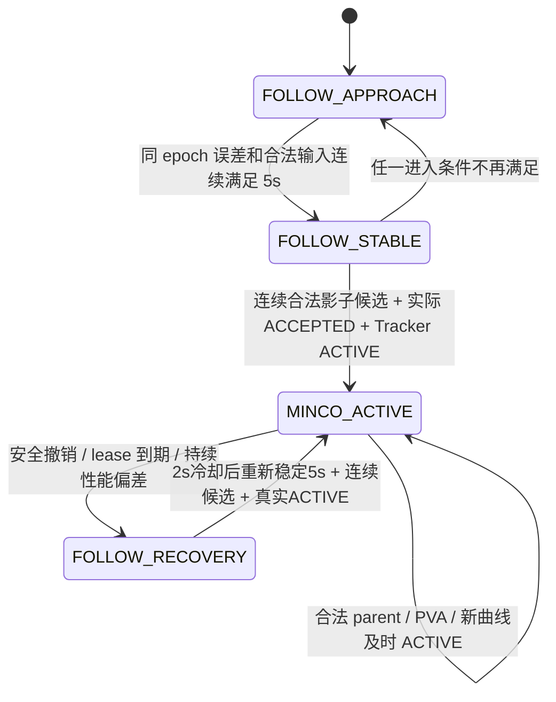

# P5.1 FOLLOW 收敛、接管与恢复

本轮基于 `51007415a87d839f8b18ebe6e78c5b4418856ee6`，继续使用 master。
实现范围是研究执行资格、接替调度和诊断；原 FOLLOW 主控制律、BCTRA、PX4、感知时间戳、
动力学/FOV/海面约束不改。固定 P47/C、qva、refinement=false、adaptive、H1.6，保留 P44/D。
**当前证据是单元测试、历史重建和离线故障回放；本轮尚未获新的实际 SITL 授权。**

图中的 ACTIVE 来自原 Tracker 的 NominalFollowReceiver。策略本身、求解成功、影子候选、
ACCEPTED 都不是实际 owner。没有增加 PX4 setpoint 发布者。

## 唯一权威门禁

`guidance/follow_admission.py` 的策略由 Tracker 内的 Receiver 持有；Planner 只读取
`/control/follow_receiver_state`。发布路径先核验这份心跳，Receiver 接收时再次独立裁定。
修改外层日志状态不能绕过接收门禁。

Tracker 与只读监视器复用同一共同 epoch 几何：KF 的 P/V 位于其原始 stamp，native nav
仅在原始物理样本间插值，括区间不超过 50ms，也支持精确同戳样本。没有 nav 外推、
采集戳替换或真值。期望 FOLLOW 点沿 KF 水平速度方向后退既有跟随距离，静止时采用
原 FOLLOW 的 +X 约定，高度使用既有 flight_altitude。门槛针对该点的误差，不是目标距离。

| 参数 | 默认值 / 意义 |
|---|---|
| horizontal_enter / relative_enter / height_enter | 1m / 0.5m/s / 0.1m |
| stable_seconds | 5s；输入或共同 epoch 缺失就重新计时 |
| horizontal_exit / relative_exit | 1.5m / 0.75m/s，性能滞回 |
| performance_seconds | 超出性能阈值持续 0.5s 才请求回退 |
| cooldown_seconds | 回退后 2s；冷却期间不积累下一次稳定时间 |
| required_probes / probe_maximum_gap | 3 个连续合法候选，间隔及最后年龄不超过 450ms |
| maximum_entries | 同 receiver/mission/clock identity 最多 3 次初始准入；后继接替不计次数 |
| maximum_sample_gap | 200ms；稳定性观测中断就重置 |

上述均通过 `follow_admission_*` 配置。研究准入默认在名义执行中启用；隔离 SITL 授权仍
由原 `require_isolated_sitl` 独立检查。P5.1 Planner 要求接收门禁，不依靠研究日志推断权限。

影子候选走原完整系数验收、Tracker 独立全曲线动力学/姿态/FOV/海面重验，ACK 为
`REJECTED / SHADOW_PROBE_VALID`，不会进入 pending 或 active。重验失败会打断成功序列。
之后才允许一次实际初始提案；接纳后错过 start 也会消耗一次准入并进入恢复。

## 保持与真正回退

MINCO_ACTIVE 时不重复应用 1m/0.5m/s 进入门槛；有效后继不会被无关冷却计时阻断。
安全检查保持立即有效：输入、导航、合法任务/Offboard、独立前缀、参考命令、原 lease
任一失效都撤销或进入既有安全路径。性能滞回不能覆盖安全撤销。

Receiver 激活时重新检查 parent 仍实际 active。跨过旧 lease 的 tick 不再激活已经失去
parent 的待执行曲线。每个 tick 的全部撤销、到期、拒绝与 ACTIVE ACK 都保留，不再仅
发送最后一个事件。Planner 额外拒绝时间、active_plan_id 或 control_owner 不符的 ACTIVE。

心跳、提案和控制 tick 任一路径观察到执行上下文失效时，就立即撤销并记录恢复原因。
离线反例“心跳见 Offboard 丢失 → 下一 tick 前恢复”不会继续原曲线。Planner 在同一
identity 内拒绝旧心跳和早于最新控制转换的 ACTIVE，每个 plan 的终态不可由重播 ACTIVE
复活；身份变化清除旧 accepted parent。三处审查问题及其回归记录见验收报告。

回退保存 plan、parent、原 start、原 lease 截止和最后合法执行上界及直接原因。
共享速度命令历史、原加速度整形和视觉 yaw 保持；未将切换速度初始化为零。
控制周期诊断增加共同 epoch 跟随误差、参考 P/V/A、实测 P/V、最终速度/加速度、yaw/rate
及整形前历史。接收时序另记为 follow_receive，避免污染每周期唯一参考记录。

实现与测试清单、尚未获得的飞行结论见 [闭环验收](p51_closed_loop_validation.md)；
450ms 接替窗口与原始超时归因见 [在线时序](p51_online_timing_and_lease.md)。
