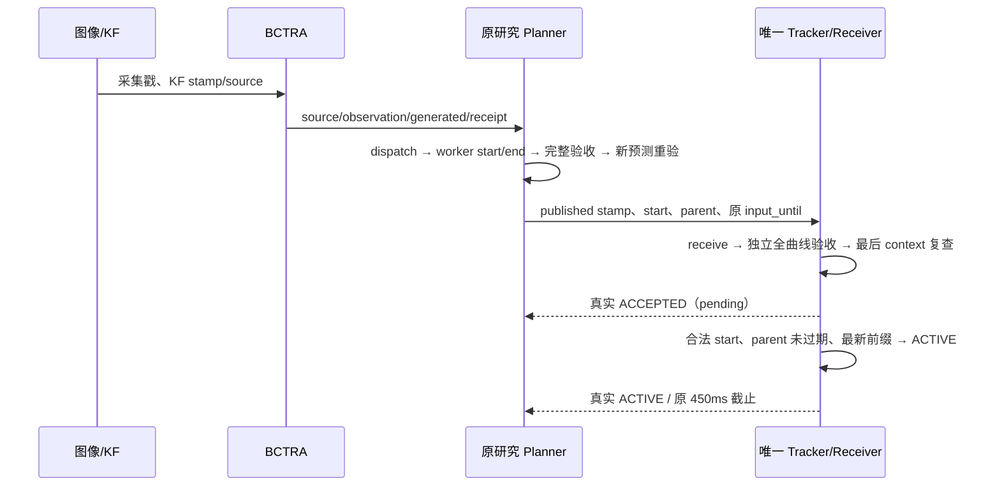

# P5.1 在线时效与名义 lease

**450ms lease、125ms 原始输入时效、50ms activation window 均未放宽。**
新分析目录为 `data/experiments/20261012_p51_offline_01/`，不覆写旧 P5/P4.5 日志。

## 历史证据

用原事件重建 b_f2_1、b_f2_2、c_f2_1、c_f2_2：131 次 MINCO→FOLLOW 仍全部关联原 lease
到期；116 次无接替 proposal，9 次接替被拒，6 次 ACCEPTED 后错过 start。
这不是把预测版本变化误当作撤销，直接原因与上游失败分开保存。

| 历史运行 | 实际 publish→ACTIVE P95 ms | 最大 ms |
|---|---:|---:|
| b_f2_1 | 157.657 | 169.609 |
| b_f2_2 | 154.130 | 163.142 |
| c_f2_1 | 153.042 | 158.844 |
| c_f2_2 | 153.590 | 167.661 |

这些是旧 H1.2/H1.6 各自人口；不是本轮 P5.1 的在线性能。旧 proposal 间隔 P95 约
1.03–1.50s，明显大于 lease；仅缩短求解均值不足以证明持续接替。

最新旧 P5 第一个请求计算余量 32.576ms，求解 38.484ms。原互斥 profile 中，系数构造
32.435ms，其中首次系数映射的大量 trajectory_samples 约 26.975ms；第二个请求完整
FOV 阶段约 51.018ms。三个请求分别还包含不同的初始化、验收和收尾；不得作为长期 P95。
本轮对三条原请求做带 cProfile 的同输入复算，原 epoch、状态和期限保持；profile 有额外
开销，结果记录为带仪器复算，不包装成在线耗时。CPU 调度/争用的因果归属仍未独立证明。

旧 P5 停止快照的 134.604ms 可按原戳分解：采集→localizer 收到 21.151ms、处理
5.142ms、处理后→KF 0.872ms、KF→预测生成 0.604ms、生成→监视器收到 3.049ms、
收到→快照读取 103.786ms。下一帧的采集→接收本身约 88.100ms，提示存在实际交付
空隙。它不是增加 125ms 门限的理由，也不足以单独确认 CPU 争用原因。
逐戳来源及哈希见 [年龄分解](audit/p51_follow_minco/input_age_decomposition.json)。

## 调度改动

P5.1 的 `p51_online_budget_guard=true` 在节点构造期间预热仅依赖固定时长和 qva 模式的
线性系数映射。不会缓存目标、输入、实测姿态、接受轨迹或执行权限。
原数学模型和完整验收保持。其他研究配置的该选项默认 false，以保留旧 P4.7 回归。

开启后用 45ms FOLLOW/QVA+验收、12ms P44 初始工作估计进行阶段选择；完成阶段后根据
实测耗时更新保守估计。它们是调度估计，不是实时保证或新安全门槛。FOLLOW 所需余量
不足时优先已有 P44；P44 所需余量也不足时不启动。实际完成仍必须满足原期限及独立验收。

正常调度保持 5Hz，单 worker、不排队。只有**实际 active 的后继求解失败**且 lease
余量已经不足以等待普通下一周期时，对该 active parent 最多安排一次提前重试；下次仍从
最新有效输入构造。首次未接管不会提高请求频率，也不会新增执行权限。原 parent 对应的
ACK 尚未到达、接收心跳 pending 尚未 ACTIVE 时，等待真实结果，不反复覆盖待执行计划。

计划 start 保持请求时刻 +150ms。Planner 要求后继 start 至少留出一个 50ms Tracker
周期到旧截止的余量；这是保守接替安排，既没有移动旧 start，也没有延长旧 lease。
遇到无法满足的窗口明确拒绝；真实 ACTIVE 之前仍可能因调度抖动失败，必须由 SITL 验证。

一次新求解或新候选拒绝不会撤销旧 active 或清空合法 pending。旧期限到达后仍无合法
后继则立即回退，进入接收器恢复资格；影子成功和调度提前均不能覆盖真实到期。

## 逐周期时间线

求解 start/end、Planner publication、Tracker receive/ACK 处理耗时使用 monotonic；
source/input/start/ACK 的物理 epoch 使用 ROS/PX4 时间。不能把两个时钟域互减。
原始 recorder 的 observation/KF/prediction 与新 follow_receive、proposal、ACK、
execution_debug 按真实 plan/sequence/identity 关联；缺失字段必须保留为未知。

P5.1 的实际接替成功率、无接替人口、在线超时及最终命令平滑性均尚无新飞行证据。
故障回放的 clock=0 是明确的确定性测试夹具；其实际计算耗时另记，不能用于在线资格。
