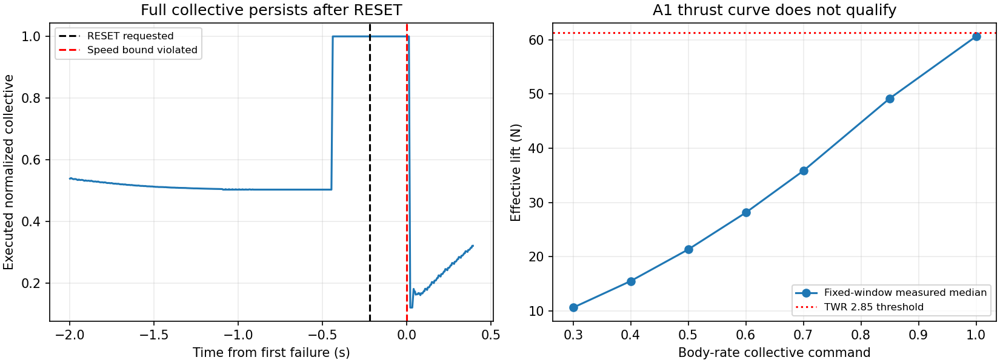
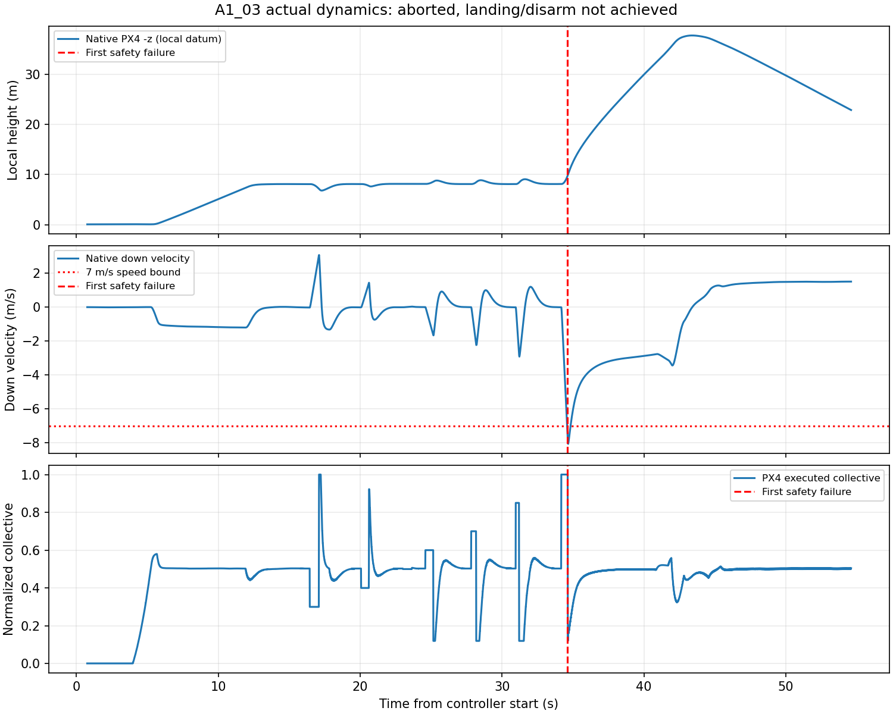

# P7.6.2：实际 A1 校准、首个动力学阻断与资格判断

日期：2026-10-21。分支 `codex/p76-paper-faithful-yolo-dkf`。起点 `2609bbf0096f531f84a691c0d128e25b4d842dd9`，起点工作区干净；本轮实现提交 **`a4779cd28e7dce53ade41f0dc9492aa70ad1547c`**。

**A1_03 已真实执行，但未合格；A2 未运行，没有生成 A，当前不能进入 B。** 因果配对修复在这次飞行中不再触发旧 bracket 故障；新首个阻断是满推力段结束后 PX4 执行推力撤除滞后，导致上升速度越过原定 7 m/s 安全边界。未为了通过门禁延长推力段或降低标准。

证据包：[20261021_p762_calibration_01](../../data/baselines/20261021_p762_calibration_01/README.md)。完整原始会话：`data/experiments/20261021_p761_01/session_A1_03/`；离线分析、图及本轮检查：`data/experiments/20261021_p762_01/`。旧两轮失败及 [P761 基线](../../data/baselines/20261021_p761_completion_01/README.md) 保持原字节。

## 1. 飞行前修改与冻结

只修改四个校准相关运行文件及测试：`p76_bodyrate_calibration.py`、`p76_calibration_analysis.py`、`p76_calibration_manifest.py`、`p761_session.py`。PNG/LOS/IBVS/FOV 增益、YOLO、滤波阶段、BCTRA/MINCO、32° 相机和支架、USV 轨迹、0.25 m 捕获及触海规则均未修改。

- `completed` 只表示动作流程完成；`qualified` 还要求固定实测标准、当前身份及完整日志；`success` 要求两者与无故障、实际落地/解除解锁同时成立。执行器按 `success` 返回退出码，不能由 `completed=true` 放行。
- 新增 `stage_assessment.json`，独立重算保存的原始样本及分析，核查源码/合同/模型/权重/PX4。不改写旧 `run_result.json`。
- 订阅 PX4 **已存在 DDS 导出**的 `vehicle_land_detected`，同时核查实际 arming_state；等待超时不再冒充完成着陆。没有改 DDS。
- 因果配对仍从短 PVA 历史选择已完整到达的姿态/高度基准，年龄≤125 ms、姿态括号≤50 ms，无外推。补齐控制时钟回退时清空导航/姿态/高程历史并撤权的确定性缺陷。
- 增加配对源年龄记录、实际悬停油门统计和 A2 下沉量记录。未改七档推力、角速度、机动动作时长或安全包络。

飞行前定向 **20 passed**；lint、shell、diff 检查及两包构建通过。所有源码与配置在 A1 前冻结，飞行后没有修改参与指纹的源码。`audit/frozen_identity.json` 与 A1_03 实际 `identity.json` 保留完整逐文件指纹。

## 2. A1 实际执行与配对统计

本轮只启动 **1 次**新主要会话 `session_A1_03`。原任务总计 3/5；A1 本轮一次授权已用完，不自动重试。A2 的条件未满足，目录未创建，B/C/D 均未运行。

控制器实际运行 **54.740 s**，完成 native 初始化、Velocity 预发送/解锁、8 m 起飞、稳定悬停及七档推力请求；满推力后的 RESET 触发保护，三轴角速度与机动动作未执行。校准图仅有独立校准指令所有者及导航转发，不创建正式 Tracker 或目标链。

| 配对指标 | 旧 A1_02 | 本次 A1_03 |
| --- | --- | --- |
| 实际 bracket 故障 | TAKEOFF 后约 14.9 ms 即失败 | **0 次** |
| 完整配对数量 | 658 是事后导航回调回放，非实际控制次数 | **6767 个实际控制 tick** |
| 配对源年龄中位数 / P95 | 未记录相同的实飞 tick 统计 | **18.570 / 30.876 ms** |
| 最大合法源年龄 | 123.786 ms，离线回放 | **121.883 ms，实际控制日志** |
| 失败瞬间完整样本年龄 | 旧代码直接查询最新导航，未等完整配对 | **6.673 ms** |

两种计数的采样对象不同，不混称成功率提高若干倍。本次证据说明旧数据到达顺序故障未重现，不保证所有载荷下永不出现输入过期；125 ms/50 ms 门禁仍保留。

## 3. 悬停与实际推力映射

质量 **2.1948611353641296 kg**，g=9.8 m/s²。使用完整 native 姿态与加速度计算运动有效升力 `m(-R[:,2])·(a−g)`，包括气动模型不确定性；DDS 归一化推力只作输入/执行反馈，未当牛顿力。

- 实际悬停归一化 collective 中位数：**0.5028618574**。
- 合法悬停样本：**100**；相对有效推力误差 **0.1014%**，通过≤5%、≥25 样本要求。
- 七个固定窗口的测量中位数单调；最大有效推力 **60.6053 N**，对应有效推重比 **2.81759**，未达到固定 **2.85** 阈值。

| 归一化请求 | 有效升力中位数 N |
| --- | ---: |
| 0.30 | 10.6452 |
| 0.40 | 15.5389 |
| 0.50 | 21.3630 |
| 0.60 | 28.1443 |
| 0.70 | 35.8497 |
| 0.85 | 49.1857 |
| 1.00 | 60.6053 |

本轮固定短脉冲/分析窗口下能力未达到资格要求。**这不足以证明模型稳态绝对最大推力不足**：执行/电机/估计响应仍在变化；不能把后续峰值替换固定中位数、延长最大推力段或降低阈值强行通过。

三轴 RMSE、响应/超调和≥5 m/s² 机动资格均为**未测**，不填零当作性能良好。`analysis.json` 中 `count=0/rmse=null` 表示动作未执行。

## 4. 首个失败的可复算归因

首个真实失败：原始 `calibration.jsonl` **第 35919 行**，`RESET +0.218879 s`，`CALIBRATION_MOTION_ENVELOPE`。

对应代码：`scripts/p76_bodyrate_calibration.py:337` 的速度/倾斜/水平距离保护，以及 `:344` / `:217` 附近直接转为 Velocity 请求的路径。

失败时使用的完整原生样本：

- native sample：44,664,000 µs；DDS-translated sample：1792558220592064 µs。
- NED 速度 `(0.16136, −0.00370, −7.40507) m/s`，模长 **7.40683 m/s＞7**。负 z 是向上，**不是高速下沉**。
- 倾斜投影 **0.02317＜0.7**、相对初始水平位置约 **0.01856 m＜15 m**；不是这两个分支触发。
- PVA 与姿态源时刻一致、输入年龄 6.673 ms；不是旧 bracket 或数据过期。

实际时间线：

| 事件 | 相对 RESET 请求 |
| --- | ---: |
| 最后 1.00 推力段开始 | −0.225696 s |
| 请求切回 Velocity/RESET | 0 |
| 速度越界，发 LAND | +0.218879 s |
| native PX4 执行 collective 首次降至 0.95 以下 | **+0.240118 s** |

RESET 初始实测上升约 3.83 m/s；执行反馈仍保持 collective=1，使上升加速度持续，越界时达到约 7.41 m/s。模式包也在失败前仍显示 Body-rate 独占位；首次收到 Velocity 模式反馈在失败后约 13.8 ms。模式反馈本身有发布周期，不能把该接收时差当精确内部切换时刻；独立 thrust native epoch 仍明确证明了约 240 ms 的执行撤除滞后。

因此首要工程问题是**校准器退出高推力 Body-rate 段时，直接停止该接口并请求 Velocity，却没有覆盖最后的满推力保持窗口或确认实际交接**。这不是 PNG/YOLO 或目标位置估计故障。

首个失败前两秒及随后 150 ms 的 2322 条原始记录已选入 `audit/first_failure_context_2s.jsonl.gz`，包括 PVA、姿态、基准、command、collective、模式、电机等，完整全轮 raw/ULog 另存。

## 5. 安全退出与着陆边界

触发保护后立即请求 PX4 LAND 并停止校准动作。完整校准动作期间按同一完整碰撞模型、同刻 native 姿态及 PX4 高程基准离线复算的最低净空约 **6.699 m**，未触发 2 m 校准净空限制；它不代表触海/捕获资格。

LAND 后 PX4 的实际轨迹仍继续上升再转下降，native local −z 峰值约 **37.707 m**。20 s 降落等待结束时仍未落地：最后 PX4 arming_state=2、landed=false；本机 NED z≈−22.849 m，正向下速度≈1.511 m/s。不能称“已安全落地解除解锁”。有界执行器终止并清理的是 **SITL 世界/进程**。

`stage_assessment.json` 正确保存 `completed=false, qualified=false, success=false`，landed/disarmed/no_fault 检查失败，命令退出码 **2**。所有 owned cleanup 与最终只读 preflight 均无剩余 Gazebo/PX4/Agent，无硬件串口，UDP8888 空闲。没有运行额外飞行来补齐着陆或资格。

## 6. A2、正式 A 与 B 门禁

A1 的悬停、独占 Body-rate、本机导航/高程基准检查通过；推力门槛未过、速率/机动未测、实际着陆/解除解锁未完成。因此：

- **A2 不运行**；没有 0.5/1/2 m/s 下降制动曲线、可靠制动加速度、故障恢复响应或停止距离，不能用 A1 上升越界替代 A2 数据。
- 不调用资格生成器生成 A，不存在合格 `qualifications/A.json`。
- A/B/detector 路径完全不变。正式门禁仍不具备当前 A，**不允许进入 B**。
- 本轮未执行 B/C/D、重渲染、训练或论文调研。

## 7. 下一步最小措施

先修校准器的 **Body-rate→Velocity 实际交接**，不改论文算法或动作时长：在高推力段结束的同一个控制周期撤除最后高推力保持，用已测悬停附近的有界 Body-rate 退出值覆盖旧指令；发出唯一 Velocity 模式请求，并依据真实 native 模式/执行反馈确认交接。在 ACK 延迟期间保持明确的单所有者、有限期限和安全输出，避免旧 1.0 推力被继续执行，也避免反复切换模式。

先增加延迟 ACK/执行反馈的离线回归：原始约 240 ms 延迟下，退出段不得继续保持满推力；50 ms bracket、125 ms 年龄、7 m/s 速度、原有脉冲时长及资格阈值均不放宽。再核查 PX4 LAND 轨迹/减速器和目前 20 s 有界退出的关系。该建议需独立实现、冻结并获得新的有限复验授权，**本轮没有实施未经实飞验证的交接方案，也不自动重试 A1**。

交接问题解决后，再判断固定短窗口的有效 TWR 是否仍达不到 2.85；如仍不足，记录候选实测能力未达要求并停止，不能通过选择峰值或降低标准消除负结果。

## 8. 检查、身份与保存

- 定向最终验证：**20 passed in 0.41 s**（精确运行输出见 `audit/targeted_final.txt`），包含 completed-but-unqualified、实际 landing/current identity、clock-reset 清空、因果配对、恢复及原生安全。
- 修改范围 lint、`bash -n`、diff/cached diff 检查通过；两包构建 **31.1 s**，实际 ROS prefix 为本工作区 `install/uav_control`。构建后源码没有变化，未重复全量 pytest。P761 的 2380 项是先前提交证据，不冒称当前新源码的全量回归。
- 合同 SHA：`c760ba14ef15e03b1162ff578d99768394ebd2053d5ea167c9707f36bddf7b94`；完整模型文件/包络、每个运行文件、权重、固定资格路径见 `audit/frozen_identity.json` 与 `session_A1_03/identity.json`。
- PX4 binary SHA `dcf54c971b27a065a1e2bc210e45b88f7fd545b3dc1953ad5ef680f294628ef2`、DDS SHA `72dd5264c31592dd2c7e5c580eaa8732a2d8d3f03542be9a7522c4656f7952f3` 均未变。
- 原生 ULog：`04_49_41.ulg`，已按字节备份到本轮 session 并压缩入基线。旧 A1_01/02 原始日志逐文件 SHA 与 P761 清单一致，旧 baseline 校验通过。
- 代码实现 `a4779cd28e7dce53ade41f0dc9492aa70ad1547c`；当前 A1 实测身份与其运行源码一致。报告/证据后续本地提交；不合并、不推送。

当前交付是可信的悬停/七档推力负结果和明确的首次安全阻断，**不是合格 Body-rate 校准，更不是捕获成功**。
