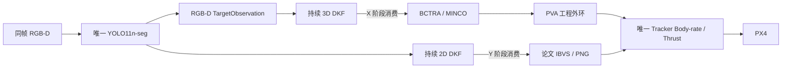

# P7.6.4：统一 Body-rate 收敛与分级验证

日期：2026-10-21。分支 `codex/p76-paper-faithful-yolo-dkf`，起点 `f0f6c4a33b0ae56f1868ee47d72247dd363f9315`，起点工作区干净。代码提交：`c8e90ccfe2d6c828abeb25654f6b5f606df54e7c`。

**结论为 A1 NO-GO。** 已修复 E0 放行矛盾、解锁推力初始化和资格身份缺口；软件回归通过，但新 A1 标定协议不可辨识、真实 E1 输入与调度未合格、E2 的长延迟压力测试失败。没有生成 A/B/detector 资格，也没有新的 A1/A2/B/C/D、飞行或捕获结果。

证据包：[20261021_p764_validation_01](../../data/baselines/20261021_p764_validation_01/README.md)。原始工作目录：`data/experiments/p764_offline_validation/`；最终复算在其 `final_evidence/`，原始唯一一次未解锁采集在 `nonflight_01/`。P7.6.3 的代码由起点提交保存，其尚未交付的离线收尾由本轮接续，没有补造历史报告或资格。

## 1. 架构及冻结边界

估计器运行、状态新鲜有效、制导消费授权分别表示。Y 撤销旧 MINCO，保持二维后验与协方差；三维继续估计，但不进入 PNG。正常 X/Y 均使用 Body-rate；独立恢复不能重新调用目标控制。默认 P7 入口及其速度接口保留，P76 仍是有资格门禁的显式候选入口。

本轮未修改论文控制公式或增益 `Ky=Kz=3、kp=0.03、kd=0.01、ka=2`，未修改 BCTRA、MINCO 多项式/规划器、相机模型、质量、电机常数或 PX4/DDS。相机仍为 32°、FLU 安装平移 `[0.35,0,0.55] m`；FOLLOW 距离 5 m、高度 4 m，复合质量 2.194861135 kg。工程外环仍为 Kp=1、Kv=2，候选加速度 5 m/s²、jerk 3 m/s³、倾角 0.45 rad，尚未取得实际跟踪资格。

真实图像年龄 125 ms、位姿括号 50 ms、实际速度 7 m/s、完整碰撞几何的海面净空及原点 0.25 m 捕获规则均保留。模式遥测独立使用既有 0.65 s 新鲜度，不扩展图像/导航时效。没有三维原点补偿、真值在线纠偏或相机布局搜索。

## 2. 关键修复

**E0 与 A1 准入。** 历史事故回归与新协议成为两个独立、有源码及原始输入哈希、可重新计算的证据。危险旧动作应被拒绝；新协议必须另有可执行动作、安全余量和有效识别窗口。校准器缺少合格协议时拒绝构建动作，没有默认七档 0.22 s 回退。E1 准入也改为真实同步输入、实际 ROS 执行器及原始回放的联合检查，旧合成 fixture 不能替代。

**解锁初始化。** 明确区分 `DISARMED_PRESTREAM → ARMED_WAIT_NATIVE_FEEDBACK → BODYRATE_READY → FLIGHT_ACTIVE`，以及 `SAFE_RECOVERY / LAND_REQUESTED`。100 次解锁前零推力预发送不初始化飞行 limiter；解锁后要求新鲜原生 P/V/R/角速度、已确认的 Body-rate 模式和真实推力。缺失或过期模式、没有安全种子、低净空不足以承受爬升，均锁存一次 LAND，不猜测悬停推力。

独立审查复现并修复两个边界：

- 不能把控制 tick 时间当解锁时刻，否则早 1 ms 到达的真实反馈也会被误拒绝。现在比较 PX4 **原生 `VehicleStatus.armed_time` 与推力 `native_timestamp`**，保留获取戳，不平移时间。已核对本机生成的 uCDR：`timestamp` 加 offset，`armed_time` 原样复制；历史 A1_03 的 armed_time=13,028,000 µs，而 status wire timestamp=1,792,558,188,956,100 µs，不能混用。
- 初始化检查上下行速度与水平速度合成后的预测模长，不能仅检查向上分量。正常飞行每次使用新鲜 native snapshot，在 MINCO/PNG 计算前检查实际速度；超过原 7 m/s 先撤权，再独立恢复或 LAND。

重复解锁消息不重复播种，解除解锁清除旧种子，时钟回退和重启不会继承旧 limiter 资格。安全检查拒绝真实地面低推力起飞时，含义是“当前启动方案不可证明安全”，没有验证出一个可飞的起飞流程。

**资格身份。** B 绑定当前 A 文件、完整实际模型、PX4 binary、DDS、检测器、合同及源码；身份原始文件也入哈希。离线审计可按原始记录重新计算实际角速度/collective/PVA 验收。Y 期间保持轻量身份检查，未把重型物理日志回放放入 200 Hz 控制回调。A2 仍要求同一正式恢复核心的实测回放及 LAND/电机/landed/disarmed 证据。

## 3. E0：历史事故识别通过，新协议不可行

历史原始文件保持不变。A1_03 原 1.0 请求约 0.22 s，退出时真实上升速度 3.8320 m/s，collective 撤除实测延迟 240.118 ms，随后速度 7.40683 m/s，越过原 7 m/s 边界。新逻辑拒绝重演；用历史起始状态计算原动作的保守峰速约 9.1213 m/s。明确覆盖旧高推力命令的制动请求只经过离线计算，没有实测新的电机退出响应。

新协议对七档候选、原生年龄、倾斜、饱和、模式丢失及上下净空独立检查：

| 满推力候选条件 | 结果 |
|---|---|
| 年龄 125 ms＋响应界 240 ms，即使请求时长为零 | 峰速界 7.154 m/s；速度余量 −0.154 m/s |
| 同一条件下停止需求与上方余量 | 需求 7.7031 m；可用 4 m，余量 −3.7031 m |
| 理想零年龄，仅作乐观离线对照 | 安全短脉冲约 5–23.021 ms，早于原 80 ms 统计起点，有效样本为零 |
| 原三独立样本要求 | 当前日志采样周期下至少约 128.004 ms；不满足短安全窗口 |

因此 `historical_unsafe_pulse_rejected=true`，但 `new_protocol_admissible=false`、`executable_steps=[]`，状态 **SAFE_REFUSAL / A1_PROTOCOL_BLOCKED / A1_IDENTIFICATION_WINDOW_INFEASIBLE**。

原短窗口有效 TWR=2.817589，固定门槛仍为 2.85，静态设计 TWR=3.0。这里不能推断稳态最大能力已不合格，也不能以峰值替换窗口中位数、延长危险脉冲或提高 motorConstant。多次独立短脉冲＋响应模型是后续研究候选，必须另审误差界与资格等价性，当前不等价于 A1。

## 4. E1：一次真实未解锁采集，未通过

只启动一次隔离 Gazebo/PX4 感知诊断；ROS 域 43，独立 Gazebo partition，采集约 30.55 s。没有 X、Y 飞行命令，没有 Tracker/mission manager，没有任何 PX4 input topic 发布者；59 条实际状态均为未解锁。Y_HANDOVER/PAPER 标签只供无执行出口的估计与影子计算验证，不是实际飞行交接。

保存了同一会话的完整检测 RLE mask/框/中心、RGB-D 原始帧头身份、TargetObservation、原生 P/V/姿态/角速度及 native/wire 时间、DDS 回调收包时刻、两套 DKF 输出和实际回调输入。**没有保存 RGB-D 像素数组**，不能用本轮数据完整复算深度几何的子原因。

| 原始结果 | 数值/判定 |
|---|---|
| 检测包 / 有效 / 推理后超龄 | 586 / 164 / 421 |
| RGB / depth 帧头 | 各 598 |
| TargetObservation | 362，**有效为零**；其中 TARGET_VECTOR_INVALID=140 |
| 原生导航 / 姿态 | 1460 / 2915 |
| 两滤波器运行 | spatial tick=1497，image tick=2086；运行不等于估计有效 |
| 二维有效输出，Y 前 / Y 后 | 423 / 1；三维 Y 后有效输出为零 |
| Y 前后内部后验/协方差指纹 | 4 次正常阶段变化均未改变；非法授权=0 |
| 有效检测接收年龄 P95 / P99 / max | 126.77 / 128.28 / 131.27 ms，存在超过 125 ms 的接收数据 |
| 真实 callback 输入旧/新回放 | 8324 条，原采集/收包历元不变；没有三维有效输入可授予持续估计资格 |

实际单线程执行器同时运行两 DKF、记录器与 200 Hz 原生状态 hold 影子外环。它不是实际 MINCO 接管测试。

| 性能 | 测量 |
|---|---|
| 影子计算 P50 / P95 / P99 / max | 0.570 / 0.976 / 1.100 / 1.522 ms |
| 调度间隔 P50 / P95 / P99 / max | 4.987 / 6.119 / 8.985 / 56.746 ms |
| 计算超 5 ms / 丢周期 | 0 / **157** |
| 原生完整配对计算 / 暂无配对拒绝 | 5768 / 159 |
| 本进程 CPU / 峰值 RSS | 约 0.717 个核 / 274.7 MB，包含记录及影子开销 |
| image tick P99 / max | 6.872 / 28.651 ms；50 Hz 截止期不能声明通过 |

另发现诊断包装器的临时 stdin pipe 随包装器退出而关闭，PX4 控制台在 EOF 下持续空转并产生大量重复提示；这污染了性能测量。已修为继承由 launcher 持有的 stdin，并用真实子进程红/绿回归验证包装器退出后读端仍等待输入。**没有第二次采集**，不能宣称修复后运行性能已合格。

不能把全部超龄或几何失败都归因给空转：本轮无法隔离其精确影响。二维检测确有有效图像，但三维观测没有成功；TARGET_VECTOR_INVALID 的更深原因缺少原始深度像素证据。原采集器将启动发现阶段的零发布者也计作 one_yolo=false，该字段原样保存；终态 graph 实际只有一个 yolo_target_detector。完整逐次 graph 历史没有保存，不补造。以上均不改变 **E1 FAIL**。

## 5. E2、捕获及分级资格

同刻 MINCO PVA/偏航/偏航率、反馈方向、NED/FRD、角速度/推力符号、加速度/jerk/倾角/输出 slew、租约失效及交接的软件测试通过。执行时刻前馈与 native 采样时刻误差反馈分开，避免将旧位置直接与当前参考相减。

交接回放使用实际 runtime/PaperController 与内存出口：FOLLOW/Y_HANDOVER 的 `PaperController.step` 调用数分别 **0/0**，ACTIVE=5，PNG 初始化=1，MINCO 撤权=1；旧 MINCO 重入被拒绝，恢复调用目标制导=0，三维目标读取=0，首次输出连续性通过。它是合成 native 包的分派验证，不是飞行。

有限、预先固定的简化闭环同时包含推力和角速度响应延迟：20/120/240 ms 收敛；500 ms 场景终点误差 **0.6581 m**、速度 **0.5194 m/s**，未满足预定 0.15 m 终点要求。因此 **E2 总体 FAIL，部分软件子项 PASS**。未调增益或阈值消除负结果；实际三轴响应还没有测得，不能把历史 240 ms 推力退出延迟当成全部动力学的已知上界。

旧 P7 Velocity 日志的反事实重放产生 1231 条受限新命令；69 次参考区间外及 1 次姿态括号缺失被拒绝。没有在线真值参与，也没有以这份历史轨迹证明新 Body-rate 的闭环稳定。

A1/A2 未合格，正式 A/B 文件缺失，B/C/D 未运行；没有新的原生距离≤0.25 m 或触海评价结果。原预算三轮 A1 仍为 **3/5**；剩余两个名额不能覆盖后续五阶段，更不能伪装成新任务额度。后续证据目录与新预算须由用户另行批准，各阶段仍需逐次授权。

## 6. 验证、身份与下一步

最终冻结源码可用回归：**2493 passed, 2 skipped, 3 warnings in 39.86 s**。明确排除原有缺失 R11 历史输入的 `test_p6_sitl_driver.py` 和 `test_p6_turn_case_config.py`，不补造历史。第一次 broad 回归的文档风格失败、审查红测试均保留；因新发现的初始化及真实 E1 准入缺陷作了针对性修复与最终确认，不拿中间结果替代冻结结果。定向、flake8、shell、diff 检查和两包构建均通过；构建 91 s，ROS prefix 为本工作区 `install/uav_control`。

完整逐文件源码/合同/模型/PX4/DDS/权重身份见证据包 `source_identity.json`。PX4 binary SHA `dcf54c971b27a065a1e2bc210e45b88f7fd545b3dc1953ad5ef680f294628ef2`，DDS SHA `72dd5264c31592dd2c7e5c580eaa8732a2d8d3f03542be9a7522c4656f7952f3` 未改。诊断执行时的源码、原始结果及本轮后续修复身份分别保存，失败采集不授予修复后代码资格。旧 P761/P762 SHA 清单再次核查；最终 preflight 无遗留仿真/Agent、硬件串口或占用的 8888 端口。

下一步只做最小的有界工作：先独立审计替代动力辨识方法是否兼容原 TWR/样本标准；修正采集包装器后，另获授权才做一次带原始 RGB-D/ROI 和完整 graph 记录的未解锁诊断，定位几何拒绝及调度问题；在不改变论文增益的前提下研究延迟敏感性。三项均有可信证据后，才能提出新的 A1 方案与预算请求。当前不申请、也不自动启动 A1。

本轮源码、报告及选择性证据只在当前分支本地提交，不合并 master、不推送。
