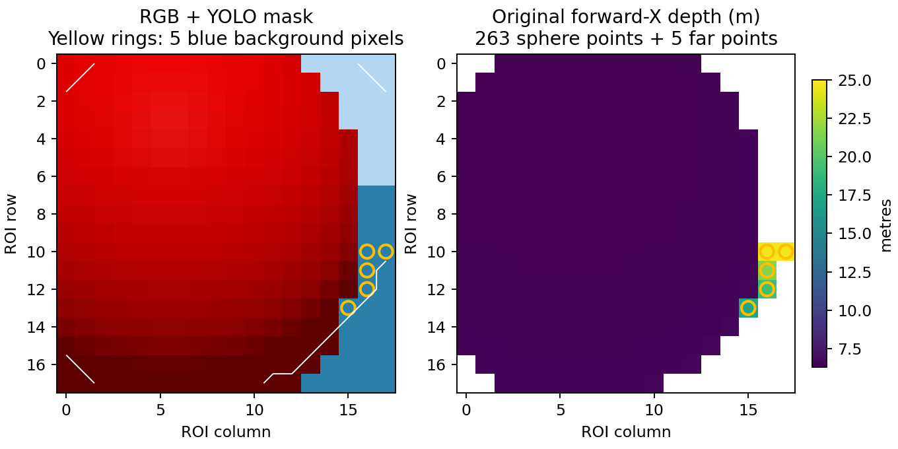

# P765：授权单次未解锁采集与根因确认

用户在本对话于 2026-10-22 明确回复“授权”，本轮仅执行预定的一次 30 s 未解锁 ROI＋时序采集。运行 HEAD 为 `f5c8338`，原始单次 claim 保留；没有第二次启动、解锁、起飞或 A1–D。没有修改在线源码、参数或模型。

证据包：[20261022_p765_unarmed_01](../../data/baselines/20261022_p765_unarmed_01/README.md)。此前纯离线阶段保持为[历史报告](p765_remaining_blockers.md)，原 P762/P764/P765 冻结包均未改写。

## 会话结果

| 项目 | 实测结果 |
|---|---|
| ROI 采集 | 正常结束 30.0026 s；保存 10 组原始配对，全部文件哈希通过 |
| 安全/控制边界 | 59 条 VehicleStatus 均为 DISARMED；PX4 四种输入 topic 全窗口无 publisher；唯一 YOLO |
| 图像数据 | 599 RGB、599 depth header；504 检测，其中 454 有效 |
| 三维观测 | 483 条，**有效 0** |
| 二维状态 | Y 前有效 263 次、Y 后 770 次；Y 只是影子标签，无飞行制导 |
| 后验连续性 | 四次 phase relabel 前后 posterior/covariance digest 相同；无非法授权 |
| 200 Hz 影子执行器 | 丢周期 **567**、计算超 5 ms 一次，未通过 |
| 清理 | owned/late cleanup 无 survivors/errors；最终预检无仿真/串口、UDP 8888 空闲 |

`raw_capture.completed=true` 与 `E1 qualified=false` 分开记录。程序退出 2 是保留 E1 失败，并非 ROI 保存失败。完整文件已关闭后，一些节点在清理期接收 SIGINT，以 -2 退出；清理日志和终态均保留。

## 这次三维失败原因已得到原始像素支持

406 条 TargetObservation 的拒绝为 TARGET_VECTOR_INVALID。ROI 诊断共记录 407 次 FITTED_RADIUS_MISMATCH；诊断与观测订阅窗口略有差异，不能将两个计数混为一项。十份保存的像素数据相同，来自不同原始采集身份：这是一个静止视角的重复采样，不能当作十个独立场景。

一个掩码含 292 像素：

| 像素分类 | 点数 | 原始深度 |
|---|---:|---|
| 红色球面 | 263 | 前向 X 约 6.3004–6.5402 m |
| 被 YOLO mask 包进来的蓝色远背景 | 5 | 17.3914、19.2826、21.6354、24.6421、24.6421 m |
| 非有限深度 | 24 | 被原有效深度检查排除 |

五个远点 RGB 均为 `(41,127,168)`，与球面红色不同；它们落在同一平面上，camera FLU 单位法向约 `[-0.53105,0,0.84734]`，平面残差最大约 `2.62e-8 m`，与当前海面背景相符。RGB 与 depth 在这些像素的颜色/距离关系一致，且来自完全相同的 raw 采集身份。

**确定的问题是 mask 内混入远背景，而 ideal 球拟合把全部 268 个有效深度点视作同一球面。** 仅 5/268（1.87%）个远点已使代数最小二乘拟合半径达到 **10.8641 m**，原 0.25 m 球的半径一致性门槛因此正确拒绝。该拟合 rank=4、condition≈101.86；本次首先失败的是半径一致性，并非点数不足或 rank 退化。

这不能反向证明旧 P764 的 140 次每一条都是同一子因，因为旧深度未保存；同场景、同 mask 的新证据强烈支持这一机制。当前数据也不证明所有运动/距离的相机几何都正确，但无需以轴偏置、真值纠偏或放宽残差解释本次失败。

## 离线反事实验证，尚未改在线链路

按已知球直径 `2r=0.5 m` 对有效深度做固定分层，选择 263 点的主要前景，仅重跑原几何函数；没有优化阈值或改球半径/残差/条件数门槛。十份原始样本中，原 mask 拟合均拒绝；分离远背景后均通过原球面判据：

- 拟合半径约 **0.248334 m**。
- 径向残差 P95 约 **0.001947 m**。
- camera FLU 球心约 **[6.548266, 0.011817, 3.965841] m**。
- 保留前景占原 mask 263/292=90.07%，没有以很少点强行凑球。

这是点关联的离线反事实，不是已上线的修复。它只说明“去除已证实的远背景后，现有球面几何可以工作”；尚未制定并验证适用于遮挡、多个深度层、前景干扰和不充分球面片的在线关联策略。ideal 路径的默认 fit std=0 不能解释成实测零不确定度；没有可信实际三维状态与协方差资格。

后续首要修复应是 **P76 的 mask→depth 前景关联**，保留原始统计及原 mask、显式记录被排除点；歧义/支持不足/曲率不足继续拒绝。不能把 max_depth 盲目调小、改用 RGB 颜色作为新在线回退、关闭 require_valid_sphere 或放宽半径/残差来制造通过。本轮没有接入这项新关联行为，也未重启仿真。

## 实时性：图像有效率改善，调度仍失败

同一硬件/场景/物理模型，但本轮增加 ROI、实际进程身份与逐核资源记录，二维有效更新也更多；不属于完全等负载消融，不能单独量化 EOF、worker 或 writer 各自贡献。

| 指标 | P764 原数据 | 本次 |
|---|---:|---:|
| 检测有效/总数 | 164/586（27.99%） | 454/504（90.08%） |
| inference P50/P95/P99 | 51.04/66.58/83.43 ms | 53.41/90.08/128.19 ms |
| 原采集→完成年龄 P50/P95/P99 | 137.59/175.16/185.62 ms | 98.25/139.61/177.94 ms |
| 200 Hz 唤醒 P50/P95/P99 | 4.987/6.119/8.985 ms | 4.987/8.915/14.351 ms |
| 最长唤醒间隔 | 56.746 ms | 25.668 ms |
| 影子计算 P99/max | 1.100/1.522 ms | 1.537/5.125 ms |
| 丢周期 | 157 | **567** |

本次最新帧替换 92 次；选中帧原采集→detector 收包年龄 P50/P95/P99 为 16.11/26.96/30.77 ms，pending wait 为 25.43/46.79/50.74 ms。这些分位数不能直接相加。有效检测的 collector 收包年龄最大仍可到 133.67 ms；消费者原 125 ms 检查继续拒绝过期输入，没有重新标新鲜。

本次 inference 尾部没有改善，发布有效率的改善主要与有界最新帧策略等组合变更相符，不能称模型推理提速。Y 后二维状态持续可用明显改善，但三维仍为零，E1 仍不可通过。

200 Hz 与双 DKF 在本诊断中共用一个 SingleThreadedExecutor。图像 receive P95≈8.536 ms、tick P95≈7.298 ms，已超过一个 5 ms 周期。439 个有丢周期的间隔中，423 个与顶层 image callback 时间段重叠，对应 551/567 个丢周期。嵌套 callback 未重复计数；这是直接阻塞机制和时间重叠证据，不是排除 OS/GIL/序列化竞争后的独立因果分解。

**诊断的共进程执行器未满足 E1；不把它等同生产独立 Tracker 进程的实际性能。** 生产 200 Hz 控制本轮未执行、未授予资格。几何修复之后，应让断开输出的 200 Hz 影子控制与 DKF/记录处于独立执行进程，再做有界实测；本轮不消耗第二会话。

EOF 空转未重现：本次 PX4 控制台原文约 6.9 KB，进程平均约 0.205 个核心。旧 PX4 未保留同口径逐进程 CPU，因此不报告“CPU 降低百分比”。本次窗口内 collector 约 0.891 个核心，RSS 采样峰值 215.8 MB；外部资源监测连同收尾阶段峰值约 300.3 MB，两个窗口不能混用。YOLO约1.103、localizer约0.686、Gazebo约0.590个核心；16核逐核原始计数保留，主机核心活动不能全部归因本实验。

## 放行、证据及停止边界

四个原始流的 run_id、同目录及互相 SHA 绑定通过；重新执行独立 E1 放行器得到 `P765_E1_RECOMPUTED_NOT_QUALIFIED`。模型27个文件逐一校验且与历史冻结模型相同；实际 localizer/detector loaded-code 身份及运行源码副本保存。没有合成数据混入真实流。

结论仍为 **E0 BLOCKED、E1 FAIL、E2 FAIL、A1 NO-GO**。E0/E2没有新控制源码变化，不为本次视觉诊断机械重跑无关离线压力测试；本轮无运行源码变更，不重复完整回归或构建。新增分析工具实际重放10份ROI、核验原始/分层拟合及独立门禁，并保留可复算脚本和SHA。

授权的一次采集已用完，单次 claim 保持。没有自动重试，也不因原 A1 历史余两个名额继续飞行。下一步是先完成上述深度关联的离线设计与验证；任何后续 Gazebo/PX4 会话仍需另行明确授权。
