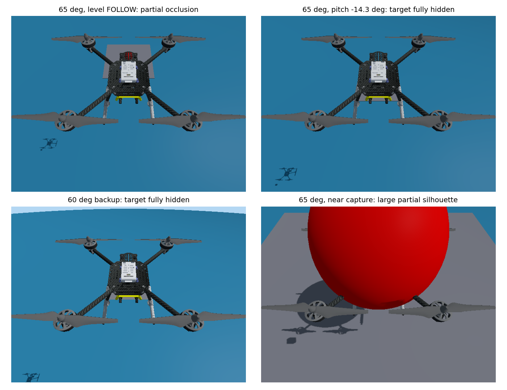

# P7.6 Yan 2025 全局复现：实施与验证记录

日期：2026-10-20。分支 `codex/p76-paper-faithful-yolo-dkf`，精确起点 `944c684ef36389743e856bad19cdabb7868b4655`。master 保持 `52e7aab`；P7.4/P7.5、默认0.50m配置及原始实验保留。**已接入候选代码和真实检测链，但未完成论文式飞行闭环；A/B/C/D 未获资格，不能宣布0.25m捕获成功。**

## 1. 文献与实现边界

已读取本地 Yan论文II–V节和[28] Yang论文IV节/Algorithm2，并渲染核对公式页面。文献来源为 [Yan作者预印本v2](https://arxiv.org/abs/2409.17497v2)、[Yang作者预印本](https://arxiv.org/abs/2404.08296)。本地PDF哈希及提取文本保存在 `data/experiments/20261020_p76_audit_01/`。作者公开材料仍未消除以下印刷/量纲问题；第三方仓库的实现不能当作作者确认。

| 公式 | 对应代码/职责 | 原样与适配边界 |
| --- | --- | --- |
| (3) | `p76_paper_png.camera_los`及图像DKF输出 | 使用原始640×480像素中心误差，不拿P7归一化误差冒充像素 |
| (5) | `p76_paper_png.camera_los` | 光学右/下/前→相机FLU→机体FRD→NED，完整姿态；方向与相机原点分开。旋转后的单目射线无法独自求得有安装平移/标记偏移的UAV→USV原点方向，此近场视差必须独立报告 |
| (7)(8) | `paper_angles` | 垂直atan2(z,hypot(x,y))、水平atan2(x,y)；atan2在原前向半平面与原式一致，跨象限属于明确工程扩展 |
| (9)(10) | `DualPlanePng` | 前一次实测速度角加3倍LOS角增量；双平面，单位方向重构，包角/重复估计/低速度保护；不用旧四元数PNG |
| (11)–(13) | `p76_paper_ibvs.image_yaw_rate` | 像素PD，kp=.03、kd=.01；坐标层映射为FRD物理yaw轴 |
| (14)–(16) | `fov_holding_velocity` | 印刷vd=vnow+ka未说明向量/周期且与atan(ka/g)量纲不一致。采用明确标注的工程解释：受ka·dt约束的速度向量变化，结合PNG限制加速诱导姿态/图像垂直变化；不每5ms增加2m/s，也不以边界减速替代该逻辑 |
| (17)(18) | `p76_paper_attitude` | 实际dt求加速度，NED重力与升力方向；物理可实现性约束另外记录 |
| (19) | `rotation_between` | 印刷r=nf×nfd非单位轴，直接代Rodrigues一般不属于SO(3)。用单位轴和一致转角，零角/180°显式处理 |
| (20)–(22) | `attitude_rates` | 原(20)与后续推导转置不一致；按(21)(22)反对称姿态误差实现，并用独立轴向测试验证稳定方向 |
| (23) | `p76_paper_thrust`与唯一Tracker | 印刷ad−mg混用加速度和力；工程物理实现m·nfᵀ(ad−g)。印刷重复ω1标签及yaw分量位置以明确FRD转换说明，保留角速度范数/分轴/变化率饱和 |
| [28](30)–(36)、Algorithm2 | spatial/image delayed filters | 历史采集时刻更新与重放；本任务6维/4维滤波状态是工程降阶，不冒称原文含姿态、位置、速度、图像、惯性bias的大状态EKF逐项同构 |

论文定义相机点和机体点近似重合；新任务相机平移、红球中心与USV参考点偏移均超过部分捕获余量。不能仅凭式(5)旋转一个单目单位向量声称已经补偿平移，或把命中红球中心等同于原生USV原点0.25m捕获。

## 2. 起点与历史资格

开始P7.6时当前工作区干净，用户指定的P7.5提交存在，创建分支成功。配置、源SDF、论文及master/P75 SHA保存在 `baseline.json`。两远端均指向本仓库。

指定P7.5提交的报告记录28°布局未捕获且未放行飞行；原始独立证据目录还保留之后的65°探索：理想模型两个固定相位11.20/12.30s进入0.25m，随后一次真实A因持续无有效图像未取得MINCO接管。其外层停止记录HEALTH_INPUT_LOST，底层TARGET_LOCK_LOST_FOR_2S；不能把该A当成功资格。本轮不改写P7.5报告或原件，也不继承它的飞行资格。

## 3. 全局依赖与参数审计

完整源级参数读取/声明/发布/订阅矩阵见 `parameter_inventory/dependencies.json`，每项保留文件、行号、实参表达式；动态表达式明确标记需运行时审计，不伪装成已解析常量。

| 层与现有入口 | 原输入/输出 | P7.6阶段及接入要求 |
| --- | --- | --- |
| `start_px4_ros2.sh`、`uav_lab.sh`、`p7_follow_sitl.py`、modular launch | 会话SDF、PX4、ROS进程 | 新候选显式选择，启动前校验合同/模型/权重/资格；旧入口不默认为P76 |
| `rgbd_target_localizer` | 独立颜色检测+对齐深度→TargetObservation | FOLLOW消费共享YOLO mask，保留同图像姿态等待/采集戳/0.42m标记偏移；无颜色fallback |
| `target_bearing_node` | 独立颜色检测→TargetBearing | 同一YOLO中心/模型SHA，不自行检测 |
| `front_tof_monitor` | 独立颜色检测→图像/深度诊断 | 同一mask，RGB/depth/时间质量分别报告 |
| `target_kalman_filter` | 观测→`/tracking/target_state` | P76 launch排除；由spatial_dkf唯一提供FOLLOW状态 |
| BCTRA/IMM predictor | `/tracking/target_state`或原观测→预测 | 正式FOLLOW选择BCTRA；Y撤权后停止不需要的在线预测 |
| MINCO Planner/Tracker admission | 预测/姿态/相机合同→轨迹/租约 | 4m/5m、新相机；Y后撤销租约并停止优化，不能只声明shadow可行 |
| MissionManager/visibility | X/Y、锁定、Tracker诊断→任务阶段 | MissionManager确认Y；handover与image-DKF锁定分开，Y后不依赖持续3D DKF |
| 唯一Tracker | PX4 native状态→Offboard heartbeat及setpoint | FOLLOW速度；PAPER_ACTIVE只Body-rate+归一化推力，200Hz目标；旧_fast_step/velocity guard不再整形论文输出 |
| evaluator | nativeGazebo参考点→SUCCESS/SEA_CONTACT/暂停 | 原生3D≤.25m，触海仍失败；不向滤波/控制反馈真值 |

`p76_contract.yaml`保存论文值、工程候选、时效、相机与模型资格来源；`p76_yan_paper.yaml`由绑定函数生成。跨节点不一致拒绝启动。当前参数一致性通过不等于飞行资格，审计明确返回 `flight_qualified=false`。

## 4. 动力学初审

实际组合模型为本仓库x500_mono_cam→PX4 x500→x500_base。每个有质量link的质量/惯性、collision、模型哈希及四个电机参数见 `composite_model.json`，不以YAML速度上限代替动力学能力。

源电机k=8.54858e-6、最大角速度1000、上升/下降时间常数.0125/.025s、力矩比.016。候选TWR3需从完整组合质量反算电机常数，且只修改会话副本。ESC MIN=150/MAX=1000和MPC_THR_HOVER默认.6只说明配置；实际归一化推力→电机响应还经过PX4分配/模型，必须实测校准，不能直接把sqrt(F/Fmax)写成已验证映射。

相机合同为模型原点(-.25,0,.55)m；base_link位于模型原点+.24m，故相对base_link的初始SDF平移应为(-.25,0,.31)m。相机/机架遮挡仍须实际或独立几何验证。

## 5. 实施与资格状态

实施计划见 `docs/superpowers/plans/2026-10-20-p76-paper-faithful-yolo-dkf.md`。YOLO训练/推理依赖安装在独立项目虚拟环境，原Python/旧P7环境不替换。开始时缺少模型、数据集及后端，后续安装成功也不自动构成检测能力或实时性证据。

候选已接入真实YOLO、共享mask消费者、3D/2D DKF节点、模式协调、论文控制核心、唯一Tracker的Body-rate出口、专用launch及会话模型准备。正式启动会检查合同、实际SDF、真实权重和实测资格；缺少资格时明确失败，不静默使用旧P7或颜色检测。**代码接线和数学测试不等于实际PX4接管。**

## 6. YOLO训练、独立测试和实际ROS时延

真实单类别YOLO11n-seg使用官方COCO预训练权重作初始化，在本机隔离CPU环境训练，不把原始COCO权重冒充red_ball检测器。Ultralytics8.4.183、torch2.7.1+cpu、ONNX Runtime1.23.2；固定416输入、单线程推理。Torch/ONNX环境中的新Protobuf与系统Gazebo旧生成消息不兼容，检测进程显式使用Python Protobuf解析；系统ROS和旧P7环境不替换。

| 数据会话 | 采集快照 | 正标注快照 | 实际图像数（含负样本） |
| --- | ---: | ---: | ---: |
| train_session31 | 180 | 123 | 216 |
| val_session47 | 60 | 49 | 72 |
| test_session61 | 60 | 43 | 72 |

这是实际Gazebo渲染的独立静态姿态会话，覆盖不同姿态、距离、升沉、部分出画和背景；**没有宣称采集了实际高速飞行转弯序列**。离线配对背景差分/颜色仅用于标注，正式节点只有ONNX YOLO输入。按会话分组且检查跨会话图片SHA重复。

训练30个epoch上限、freeze10、batch8；验证框mAP50约0.978、分割mAP50约0.952。独立测试集真实ONNX推理为41/43可见正样本检出，召回率95.35%，29负样本零误检，分割可见区域IoU中位数0.938。**检测框中心相对真实投影球心误差中位数13.62px、P95为215.99px**：部分出画/遮挡时可见框中心并非完整球心，此指标尚不适合精确近场制导。

ONNX文件SHA256：`4fb70adc8fc0989eea52831bfbd62550f48cb21cfb39dd07a4f7f68035c65ef8`。训练best.pt SHA：`3510c31977bd289c6d4e5ea1bcf98db9e331e1760fee7fa7571034af1152e9ef`。合同指向忽略实验目录中的ONNX；新基线包另保存同字节恢复副本。

实际时延使用Gazebo传感器→ros_gz_image→真实ONNX→ROS订阅接收，保留原始采集戳，未用重放时的当前时间改写。纯传感器测试不连接PX4、不发布飞控指令：

| 会话 | 检测输出Hz | 推理中位数/P95 | 采集到接收年龄中位数/P95 | 有效包最大年龄 |
| --- | ---: | --- | --- | --- |
| live_graph_02，定时处理 | 17.49 | 46.00/52.58ms | 103.35/111.42ms | 121.01ms |
| live_graph_03，到达唤醒 | 19.995 | 46.09/49.07ms | 71.65/80.40ms | 122.98ms |

定向修复为图像到达/时钟区间就绪时唤醒推理，仍保留有界最新帧缓存和显式超时。最后一轮255个包中138有效、114无检测、3个推理后超过125ms被拒绝，**没有过期却标记有效的接收包**。场景包含有意隐藏目标和机体完全遮挡，不能把114个无检测简单称为模型漏检率。ROS图确认唯一YOLO发布者、唯一主`/tracking/target_state`发布者；组合节点在清理前全部存活，PX4命令发布者为零。

这些是无PX4/MINCO计算负载的传感器链测量，后续原生状态接口适配仍须在当前冻结源码上重做飞行资格。不能把19.995Hz或122.98ms外推为完整飞行时的时效保证。

## 7. 主/备用布局实际遮挡：未通过

两组各33个实际组合模型静态姿态，包含15个FOLLOW工况和18个终端/升沉工况。独立逐像素射线与已知球体求交给出无遮挡理想轮廓，再与配对渲染可见区域比较，避免把可见框或理论中心在视场内当作无遮挡证明。

| 布局 | 平飞FOLLOW可见面积比例，升沉−0.15/0/+0.15m | 完全遮挡FOLLOW工况 |
| --- | --- | --- |
| 主：65°、5×4m、T=(-.25,0,.55) | 25.5% / 40.4% / 63.8% | 3/15 |
| 备：60°、5.5×4.5m、同T | 29.8% / 27.1% / 44.6% | 3/15 |

两套布局在机头上仰约14.3°时，目标理论中心仍在画面内，却被机身完全遮挡。相机位于机身后上方、朝前下方观察，机身/旋翼占据关键射线区域。备用布局没有消除这一结构问题，因此未选用备用，不继续搜索角度或增益。

原生参考点还存在独立的可达性限制：UAV原点高度≥0.33m时，USV原点升沉−0.15/0/+0.15m对应的最小垂直距离为0.48/0.33/0.18m。前两者即使水平误差为零，也不能满足0.25m三维半径。只有USV高度至少0.08m时才存在几何命中区域。这不表示所有相位永远不能捕获，但证明不能靠单纯增大下降速度保证任意首次进近命中。

第三个近场问题是参考点：像素LOS指向红球中心，红球比USV原点高0.42m，相机又有非零平移。只使用二维像素/旋转补偿无法唯一求得UAV→USV原点方向。静态水平姿态下，相机与标记中心重合所对应的UAV/USV原点偏差范数约0.282m，已超过0.25m；实际姿态还会改变该关系。没有把旧3D KF或真值暗中接回Y来掩盖这个问题。

## 8. DKF、交接及控制实现的实际边界

3D DKF只在FOLLOW更新并发布主目标状态。2D DKF在FOLLOW只缓存检测，Y_HANDOVER才使用近期合法观测初始化；必须取得Y之后的新合法图像才能授权。Y_HANDOVER→PAPER_ACTIVE保留同一后验，不重新初始化。时钟/导航坐标重置清空历史，SAFE_RECOVERY锁存，不自动返回FOLLOW。

历史延迟更新与按时间重放通过独立顺序更新参考测试，Joseph协方差更新保留正定性；重复图像和预测不续期。二维估计投影到**已经收到的导航/姿态共同时间**，姿态只在≤50ms区间插值，不把ROS当前时间冒充已存在的载体姿态。角速度和姿态协方差来自PX4原始VehicleOdometry采样，保留DDS线上的timestamp_sample和因果恢复的native epoch。**尚未完成真实飞行3D DKF对旧KF误差比较或真实Y阶段2D DKF收敛验证。**

Tracker持有原速度和新增VehicleRatesSetpoint两种接口；Y路径由目标200Hz独立timer驱动，旧20Hz路径返回，不经过`_fast_step`、precision辅助函数或FlightGuidance速度整形。OffboardControlMode仅body_rate为true。原生图像时效、3D滤波冻结ACK、实际PX4模式确认、实测校准和25s FOLLOW资格都参与接管；PAPER阶段不以持续3D目标消息为门禁。

推力反馈及PX4模式ACK使用同一因果时钟映射旁路，分别保留采样时刻/模式发布时间，不以ROS回调接收时间更新授权。实际PX4控制器送入分配器的推力setpoint与电机物理推力仍是不同层级，后者必须在A校准中验证。**当前DDS未导出前者，因此未实际完成该交接。**

海面屏障使用完整姿态下的碰撞下缘、原点0.33m边界、测得响应延迟/最大制动能力，并将导航年龄和危险下降加速度计入停止距离；不足以恢复时报告失败并请求PX4安全处置。单位测试不是实际碰撞包络、倾转过程或2m/s制动校准，不能据此降低原边界。

## 9. 动力学及有界验证停止原因

| 项目 | 原组合模型 | P76独立会话候选 | 实测状态 |
| --- | ---: | ---: | --- |
| 质量 | 2.164307692kg | 相同 | SDF逐link求和 |
| 重力 | 世界9.8m/s² | 合同9.8m/s² | 静态配置核对 |
| 电机数/最大转速 | 4 / 1000 | 相同 | 静态配置核对 |
| motorConstant | 8.54858e−6 | 1.590766154e−5 | 候选由3mg反算 |
| 静态总最大推力 | 34.19432N | 63.630646N | 模型公式，非悬停实测 |
| 推重比（g=9.8） | 约1.612 | 3.0 | 候选未获实际资格 |
| 逐link惯量/力矩比/时间常数 | 原SDF | 保留；组合惯量随相机平移改变 | 未通过响应试验 |
| Hover throttle | PX4默认0.6 | 尚未实测 | 不据默认值授予资格 |
| 5m/s²、2m/s下降制动 | 未重新校准 | 目标值 | 未验证 |

当前PX4 `dds_topics.yaml`发布`/fmu/out/vehicle_control_mode`，但只有`/fmu/in/vehicle_thrust_setpoint`订阅，**没有`/fmu/out/vehicle_thrust_setpoint`发布**。不能凭“存在同名输入类型”声称实际执行推力可读；未擅自改外部PX4或把加速度估算当作实测反馈。

| P12阶段 | 本轮结果 | 原因 |
| --- | --- | --- |
| A，Body-rate/动力学校准 | NOT_RUN，未获资格 | 当前DDS缺实际推力反馈，且无当前源码/模型的实测推力、角速度及制动校准 |
| B，25s实际MINCO FOLLOW | NOT_RUN，未获资格 | A未通过；两套允许布局均有完全遮挡，不能用静态图像测试冒充FOLLOW |
| C，单次0.25m捕获 | NOT_RUN | 无当前A/B资格，近场参考点/升沉可达性也未解决 |
| D，独立复验 | NOT_RUN | C未成功 |

因此Y接受时间、交接时延、实际200Hz达成率、MINCO真实控制占比、首次1/0.5/0.25m时间、最低飞行净空、原生SUCCESS和世界暂停均为**未取得**，不是0或成功。没有为了补齐表格发起不具资格的俯冲试验。

## 10. 证据、恢复与检查

完整原始日志：`data/experiments/20261020_p76_audit_01/`及各`20261020_p76_*`独立目录。精选证据/真实ONNX恢复副本：`data/baselines/20261020_p76_candidate_01/`；逐文件来源见`sources.json`，校验见`SHA256SUMS`。不改写`20261006_pre_mpc`或历史P75原件。

实际修复并保留失败记录：Protobuf隔离环境不兼容、ROS不支持YAML别名、colcon扫描venv、旧测试只接受无条件KF的过时假设、图像定时处理多等一周期，以及交接时不应清空同epoch图像后验。包发现现只扫描src。

当前检查结果见同包`verification/`：接口/control/bringup构建通过，`ros2 pkg prefix uav_control`为本工作区；flake8、shell语法和diff检查通过。完整pytest最初暴露历史R11配置文件缺失，不能补造；最终可用套件显式排除`test_p6_sitl_driver.py`与`test_p6_turn_case_config.py`，结果为**2354 passed、2 skipped、3 warnings（33.93s）**，保存在最终日志。**不声称完整含R11依赖的套件全绿。**

正式候选入口为`p76_yan_paper.launch.py`，通过`start_px4_ros2.sh`显式选择并准备全组合会话模型。原`p7_follow_sitl.py`拒绝P76配置，避免旧速度型观察器错误放行Body-rate。`p76_qualification_audit.py`仅生成有界阶段准入结果，**不是已完成的A校准飞行器或自动C/D运行器**；这些仍待阻断解除后实现/验证。没有把这部分缺项包装成完成。

## 11. 后续解决顺序

1. 先重新设计实际相机安装平移，使规定FOLLOW姿态范围内无遮挡；本轮允许的两套布局均失败，不继续只调角度。新平移超出本轮固定安装合同，应另立明确候选并重新审计。
2. 补齐PX4实际推力反馈、完整碰撞包络/倾转包络、悬停和垂向制动校准，再决定是否有证据研究更低原点边界。本轮不降低0.33m、不放宽0.25m、不关闭SEA_CONTACT。
3. 明确Y后如何从可见标记射线恢复USV原点命中几何：需要可观测的距离/标记几何约束及遮挡球心处理，不能只靠二维框中心和旋转弥补非零平移。先离线验证，再进入新资格。
4. 在冻结源码/模型/权重下补全A专用校准驱动、真实3D DKF误差比较和25s B，随后才有资格执行C/D。论文式14的工程解释也应保留独立消融。

本轮结论是**真实检测链与候选控制已接入，结构阻断已定位，尚未完成论文式0.25m闭环复现**。
