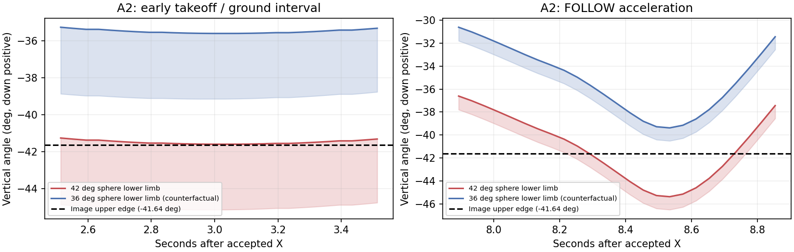

# P7.3 三维视觉导引与 0.25 m 捕获

**本轮未达到 0.25 m 首次捕获目标。** 软件候选、原实验归因及两次有界 A 已完成；48° 和
42° 候选均未通过 FOLLOW 几何门槛，B/C 未执行。默认启动已恢复任务起点的 28°／5 m
和旧 P7，捕获判据仍为 0.25 m。新方法保留在显式实验配置中，不授予实际控制资格。

## 修改与边界

- 实验候选前视相机由 28° 改为 **42°**，平移保持 SDF `(0.18,0,0.15)`、导航参考
  `(0.18,0,0.39)`；后者包含合并模型 base_link 的 +0.24 m 偏移。
  初始离线 48° 候选在 A 中暴露了起飞视场问题，已保留失败产物。实际 A 轨迹的有限
  反事实比较中，42° 在 X 前能拟合球面，最初 2 s 为 47/50 个有效样本；48° 为 0/50。
  36° 起飞几何更宽裕，但在同一光心间距/正向深度裕量下没有名义 0.25 m 入径点。
  因此曾选用 42°，配合从实际姿态计算的解析三维入径点；A2 证实该选择仍无法维持
  起飞/追赶瞬态可见性。该反事实比较本身不授予飞行资格。
  近场只要求仍有有效部分球面，不把球心或整球入画当成已自动成立。
- 实验候选 Tracker（包括起飞/FOLLOW）和 P47 参考高度由 -5 m 改为 -3 m，跟随距离仍 5 m。
  未启动的历史控制器高度未全局替换。会话模型按本轮 YAML 设置俯角，普通基线保留其
  28° 校准。A2 后源 SDF 已按字节恢复任务起点，默认 YAML 也与起点语义相同；
  候选由会话副本加载 42°，不覆盖源模型。
- `p7_spatial_guidance.py` 新增轻量三维 LOS 最短四元数增量、比例旋转、图像误差整形、
  深度相关滤波、三维运动协调和相机球面间距约束。近场使用连续混合的目标速度匹配，
  取消旧算法中不适合 0.25 m 的固定 0.30 m 下界及与 2 m/s 上限耦合的近场衰减距离。
  `capture_entry_reference` 解析计算光心球外间距 0.27 m 与正向深度 0.02 m 的交圈点；
  名义相对原点向量约 `[0.01469,0,0.24348] m`，范数约 0.24392 m。该向量随完整姿态
  变化，不是测量偏置修正；它避免把可能不可观测的水平零点当成唯一目标。
- 针对理想闭环中高度未准备好就越过目标的复现，水平反馈阻尼取
  `max(velocity_gain,4*closing_gain)`：对于名义 `closing=k*r`，该下界对应临界阻尼。
  并未盲调配置增益；原有命令连续积分、水平 2 m/s²、6.2 m/s、yaw 0.6 rad/s 与
  1.2 rad/s² 限制、Tracker 最终整形和海面保护保留。
- Tracker 使用有效 RGB-D 的原始采集戳、相机 FLU 射线及同图像 EKF 姿态/位置。
  125 ms、原始导航 epoch、因果 pose history 与超时拒绝未放宽；重复图像不产生新 LOS
  增量。Y 仍撤销 MINCO，由同一 Tracker 发布，未创建第二个指令发布者。
- P47 节点仅增加 P7 相机/高度契约接线；规划端和接收端采用同一规范指纹。P47 优化器、
  求解变量、代价、调度、时间配置、交付协议及 KF/BCTRA/P6 核心均未修改。
  [软件检查](audit/p7_025/software_checks.json)记录了受保护源码的逐文件 SHA256。

## 论文适配

| 实际参考 | 对应代码 | 项目适配 |
|---|---|---|
| Gao V-B (30a–b)、(31)、(32–33)、图 6 | 既有 `evaluate_visibility`、会话相机生成、`spatial_capture_reference` | 完整世界/机体/相机变换及有限球投影；未实现 MINCO 像素优化梯度 |
| 刘雨亭 4.3.1 (4.23–25)；(4.16) 交叉检查 | `shortest_los_quaternion`、`scaled_los_direction`、`P7SpatialGuidance.step` | 最短三维旋转保持同一空间轴，K=3；不使用两套 Euler 角积分，不每帧重设期望方向 |
| 4.3.2 (4.27–29) | `shape_image_error` 与指令限幅 | 有符号归一化图像误差，死区/过渡带均为 0.03；经针孔模型得到，非像素值混用 |
| (4.30)、(4.32–33)、4.4 算法 2 | `depth_factors`、LOS/速度一阶滤波 | 从有效 RGB-D 和已知球体估计尺度；时间常数有界，观测状态只随新图像更新 |
| (4.26)、(4.31) | 三维方向及目标速度匹配 | 保留趋近能力；未采用末端趋近量随深度趋零的策略，也未引入低相对速度成功条件 |

论文面向尾座机的姿态控制不适用于本项目；本项目保持 PX4 速度接口、独立视觉 yaw、
受海面保护的垂向分量。未引入 MPC、T3/T2 联合优化或在线非线性求解器。

## 归因、几何与软件检查

原失败轮原生最近点 **0.360932 m**（合法保持段最近 **0.360352 m**），Y 后 **13.59 s**。
首次图像失效位于 Y+23.202 s，随后制动/恢复；完整事实与时序见
[独立归因](p7_025_failure_diagnosis.md)。CSV 的 0.480986 m 不能替代原生捕获结果。

可达性为 **PHASE_DEPENDENT**。既有 0.33 m 海面参考层、0.23 m 评价安全包络和
0.20 m 导航 reserve 含义不同，未相加、互换或降低。0.23 m 沿用为现有评价包络，
捕获原点仍是 Gazebo 模型原点，不能因为 base_link/相机偏移而偷偷改变原点。
对低升沉相位不存在 0.25 m 入径走廊的情况，保持海面安全并等待条件；不声称全相位
立即捕获。完整机体 mesh 的所有遮挡情形也未由纯球投影证明。

另独立核对 PX4 `x500_base/model.sdf` 的 9 个碰撞盒：平姿态最低点比模型原点高
0.013 m；原失败轮最近点按全姿态计算，最低盒角高度约 0.29348 m。该物理盒审计
不替换保守的 0.23 m 评价包络（对应净空 0.06991 m），也未改机体或安全边界。

- 42° 软件阶段的 255 项 P7/原生几何/配置/相机/分析定向测试通过；两个包构建、flake8、shell 语法、
  diff 检查及新工作区 prefix 检查通过。
- 初始软件阶段全套结果为 **2247 passed、3 failed、44 errors、2 skipped、3 warnings**。
  三个失败和 44 个错误均来自未修改的 P6 测试依赖缺失的 R11 F3 原始配置；不补造该
  历史输入、不改 P6 资格逻辑，也不把本轮标为全套通过。
- 新 F2 使用当前 P7 目标配置，已与指定失败轮完整快照逐项核对相同；历史 F3 入口仍
  要求其真实原始文件。后续 A/B/C 以当前 P7 的初值和显式运动模式运行，不能冒充历史 F3。
- 42° 修复后三种初始升沉相位的无噪声直线/一阶响应离线探针在 8.50–11.40 s 达到 0.25 m，首次进入
  1 m 后没有再次离开；这不是 SITL 或可靠率证据。核心计算 p95 约 0.404 ms，旧分支
  约 0.043 ms，实际 Tracker 的频率/数据年龄仍须随 SITL 检查。
- `p7_capture_analysis.py` 按各轮保存的 evaluator 配置读取半径，历史 0.50 m 仍按其原始
  配置解释；不一致配置拒绝判健康。Y 帮助改为 configured radius。
  `capture_stop_policy()` 的 0.25 m 是安全高度下界，保留，未当成捕获半径替换。

## 有界仿真与真正阻断

A 首轮（48°/3 m，`20261019_p73_025_A_follow_01`）在 X 后 5.355 s 才首次收到有效 RGB-D；
此前 `IMAGE_INVALID`。未进入 MINCO，内层在锁定丢失 2 s 后停止；外层随后因停机数据
中断记录 `HEALTH_INPUT_LOST`，不能将其当成首因。两层清理均无错误或残留。

| 阶段 | 实际配置/提交 | 结果 |
|---|---|---|
| 原失败轮 | 28°／5 m，原 P7 | 原生最小 0.360932 m；Y+23.202 s 下缘离场并恢复，未命中 |
| A1 恒速八字 FOLLOW | 48°／3 m，`8075bf1` | 起飞时获取视觉过晚；无 MINCO，安全停止 |
| A2 唯一几何修复复测 | 42°／3 m，`972ab50` | 起飞多次失锁，FOLLOW 加速时上缘离场；实际 MINCO=0，未通过 |
| B 变速八字捕获 | — | A 门槛未过，未执行；Y 后耗时、最近距离、首次进近和暂停均不适用 |
| C 恒速八字捕获 | — | B 未达标，未执行 |

A2：以任务管理器接受 X 的 `1792387875.274392` 为起点。watchdog 的发送完成时间
晚 0.884471 s，不能拿它代替接受时刻。起飞早期首个 `IMAGE_INVALID` 为 X+2.881551 s；
该窗口中 42° 仅露出少量上边缘球面，理想几何最少约 5 像素，不能持续球面拟合。
X+8.090144 s 首次记录 FOLLOW；该段最后有效图像 X+8.229542 s，首个
`TARGET_VECTOR_INVALID` 为 X+8.281554 s，随后 `IMAGE_INVALID`。首个重新有效图像
为 X+8.781557 s，间隔 0.500003 s。

同刻原生全姿态投影中，X+8.293565 s 机体 pitch=-6.306°，球体下缘角 -41.684°，
已越过上边界 -41.637°；最强前倾约 -10.085° 时下缘约 -45.379°，整个球体在画面
上方。首个无效图像位于前后 40 ms 原生窗口中；未录原始 RGB，不能据此宣称获得了
真实 detector 像素计数。36° 在同一固定轨迹的该窗口 25/25 理想拟合有效，42° 为
13/25；它是反事实几何，不是另一次飞行。36° 的名义解析入径参考范数为 0.26234 m，
仍大于 0.25 m，不能只为保 FOLLOW 就宣布其捕获几何也合格。

首个 FOLLOW 无效观测发布年龄 29.752 ms，邻近导航样本年龄 21.737 ms，armed=2、
nav_state=14。观测失效先发生，现有 0.2 s FOLLOW 失锁观察门槛随后记录
`FOLLOW_LOCK_RECOVERY_TIMEOUT`。未放宽门槛，未更改 MINCO 算法；停止时还未启动
实际 FOLLOW 规划器，也没有 Y/P7 制导。两次 A 的两层清理均无错误/残留；没有捕获
终态，因此不能把清理结束解释为捕获后 Gazebo 暂停。

有限 5 m FOLLOW 姿态网格遗漏了 X 后尚未离地、目标已运动及远距追赶的全过程，这是
本轮候选选择的已确认不足。更陡的俯角改善近场可观测走廊，却压缩了早期追赶上缘余量。
继续只调 PNG 不能修复 Y 前的这个失败。后续首先离线联检实际起飞/追赶轨迹和近场
入径集合，找到同时满足两者的固定相机/高度配置；不能降低海面边界或延长失效输入来
继续 B。未证明所有固定相机方案都不可行，也未证明所有相位可捕获。

## 最终软件检查与运行边界

当前可用套件 **2248 passed、2 skipped、3 warnings**，明确排除了两个缺真实 R11 输入
的 P6 模块；初始全套暴露的 3 failed/44 errors 数据依赖仍缺失，不称全部通过。
配置隔离、会话相机、当前 F2 绑定等 103 项直接相关检查通过；两包构建、项目 flake8、
全部 5 个 shell 脚本语法、工作区 prefix 与差异检查通过。源文件与日志指纹见
[最终门槛审计](audit/p7_025/flight_gate_checks.json)。

A2 X 至恢复窗口 Tracker 周期 p50/p95 为 50.008/51.960 ms，回调 p50/p95 为
0.776/2.159 ms；首次 FOLLOW 有一次 52.931 ms 回调，不能隐去。有效观测发布年龄
p50/p95/max 为 27.457/35.616/46.019 ms。该轮没有运行 Y 后新算法，只能证明这段
TAKEOFF/FOLLOW 的时序，不能证明新增 P7 的实际回调性能。理想核心 0.404 ms 探针
同样不等于实际 Tracker 验收。运行图中 PX4 setpoint/Offboard publisher 始终至多一个，
均为原 Tracker。

## Git 与回退

诊断提交 `dc2acbf`、初始软件提交 `8075bf1`、几何修复 `972ab50`，本地分支
`codex/p73-025-visual-guidance`；最终默认回退和配置隔离提交为 `62f5610`，无自动推送。
`p7_spatial_enabled=false` 可选择旧 P7 计算分支；旧固定 0.30 m 参考不能授予 0.25 m 捕获
资格。完整软件回退应恢复本任务前相机/高度/配置及源文件，同时保留 0.25 m 判据，
不得通过恢复 0.50 m 把失败改标为成功。受保护的 P47/KF/BCTRA 核心无需回退。

本轮已经执行上述默认回退：`p7_guidance.yaml` 为任务起点配置，源 SDF 28°；新算法
和 42°／3 m 完整参数保留在 `p7_spatial_candidate.yaml`，默认不会加载。`--config`
只用于显式实验选择；自动三维捕获还必须提供同源码、同配置的合格 A/F2，不能以旧
配置的通过记录绕过。当前 A1/A2 均不具备该资格。

完成阶段：原生归因、相位/观测几何、论文适配的软件候选、半径分析一致性、定向/可用
套件、A 及一次修复复测、默认回退。未完成阶段：稳定的新几何 MINCO FOLLOW、B/C
实际 0.25 m 首次捕获、Y 后效率对比与统计可靠性。默认旧 P7 同样没有获得 0.25 m
首次捕获资格，不能把回退解释为已经解决捕获问题。全部失败日志和输入 SHA256 均保留。
