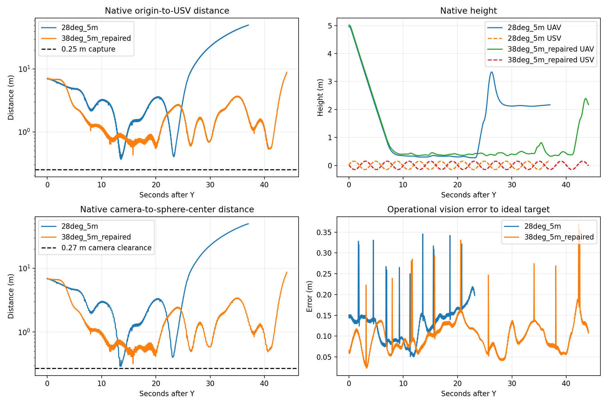

# P7 相机/高度与同刻水平参考复验

## 范围与候选

本轮按用户授权调整相机角度、飞行高度和 P7 末端反馈/水平参考；对照仅使用原始 **28°、5 m、恒速八字 4 m/s** 失败轮。未改变 0.25 m 原生三维捕获半径、海面安全、KF 核心/Q/R、BCTRA、MINCO 求解/交付协议或导航时间限制。默认一键配置仍为原配置，候选必须显式选用 `p7_spatial_candidate.yaml`。

离线筛选后选择 **38° 下倾、5 m FOLLOW**。原始飞行的 1281 帧反事实全姿态投影中，38° 整球在视场内占 98.05%；抽样的 59 个理想 RGB-D 球拟合全部有效。32°/3 m 的最小整球竖直视场余量约 2.82°，28°/5 m 为 9.78°。这些是同轨迹投影，不能视为新配置的实际闭环验收。

候选将相机球心正向深度几何余量由 0.02 m 调为 0.01 m；球面间隙仍为 0.02 m，传感器深度裁剪仍为 0.05 m。38° 水平姿态名义入口距离为 0.249724 m，几何余量很小；部分可见球面的独立射线拟合用例通过，但不代表具有统计捕获可靠性。相机平移、球半径和视觉参考点保持原值。

## 修复与证据边界

1. P7 Y 阶段将 KF 状态与已收到的原生导航样本配到同一状态时刻。仅允许原样本或不超过 50 ms 的双侧插值，观测/导航仍为 125 ms；无右侧样本则拒绝，禁止外推。最终命令整形与海面安全仍使用最新导航。原 28° 日志独立接收流回放 465/465 个时刻可配对；异步相减与同刻相减的差值中位 0.03577 m、95 分位 0.07240 m。这不是整体定位真值 RMSE 改善证明。
2. 末端水平终点取捕获圆、相机球面间隙和正向深度约束的闭式交集；进近参考随实际剩余高度从 Y 时相对位置向终点收敛，避免仍在高处便追逐最终厘米级水平点。无可行交集时保留位置参考与安全高度，不用速度匹配替代位置反馈。
3. 增加同刻反馈、导航 bracket、最终水平终点和中间水平参考诊断。Gazebo 球心诊断只供评价，未接入控制。

未校准的一阶转弯动力学探针仍未捕获：最新探针在 20.35 s 产生无效理想图像，最小距离约 0.33180 m。该模型把加速度直接转换为机体姿态，不能替代 PX4，但其负结果必须保留，不能称离线捕获通过。

## 实际验证

第一版源码 `d3981d6`：相关测试 134 项通过，可运行回归 2267 项通过、2 项跳过、3 个 warning；两个节点包构建成功，flake8、5 个 shell 语法、diff 检查通过。完整测试中依赖已不存在历史 F3 配置的两个 P6 模块未运行；没有补造该输入。15 个受保护源码哈希与上一阶段一致。

实际 A：`data/experiments/20261019_p7_angle_follow_01/`，约 24.950 s 实际 MINCO 100%，零回退，诊断覆盖 100%，健康与当前源码资格通过，清理无残留。

实际捕获 1：`data/experiments/20261019_p7_angle_capture_01/`，恒速八字，Y 前当前轮实际 MINCO 约 6.29 s。未捕获，因 `P7_TARGET_LOST_FOR_2S` 停止，无暂停终态。相对 evaluator 接受 Y 的时刻，原生最近 **0.587903 m / +8.320 s**，水平 0.206730 m、垂直 0.550357 m；USV 此时在海面以下约 0.145790 m。首次无效图像为 Y+8.348 s，原生球体随后整球从下缘离场。唯一 Tracker/BCTRA、速度接口及退出清理正常。

与原 28° 相比，当前这次最近距离更差（原为 0.360932 m）。不可将两轮不同升沉/轨迹相位的最近距离差全部归因于安装角。新轮 1–3 m / 3–10 m 原始视觉对理想轨迹 RMSE 为 0.09425 / 0.08854 m，原轮为 0.12997 / 0.14564 m；0–1 m 两轮均约 0.157 m，样本数和工况不同，不能称普遍定位精度提升。新轮近于 1 m 时原生球心诊断 RMSE 约 0.03046 m；原轮未开启该项，无法补做同定义比较。

第一轮证据确认：几何不可达期间仍追逐最终小水平参考，且远于近场时把二维位置纠偏投影成 LOS 标量，丢掉横向保持分量；实际闭合在最后数百毫秒仍约 1–2 m/s。进行原任务允许的一次定向修复：无捕获交集时按实际垂向间距与完整姿态保持光轴上的水平参考，并保留完整二维位置反馈。相关 135 项测试通过；简化转弯探针 60 s 未再出现无效图像，但最近 0.61186 m，仍未捕获。该修复不改变相机角度/高度、限速/加速度或任何安全门槛。

最终源码 `3e0d649`：相关测试 **135 passed**，可运行回归 **2268 passed, 2 skipped, 3 warnings**，两个节点包构建成功（31.2 s）；检查范围与历史输入缺失边界同上。

实际 A2：`data/experiments/20261019_p7_angle_follow_02/`，24.947842 s 实际 MINCO 100%，零回退，诊断覆盖 100%，当前源码与配置资格通过。

实际捕获复测：`data/experiments/20261019_p7_angle_capture_02/`，恒速八字 4 m/s，Y 前本轮实际 MINCO 约 14.31 s。未捕获。首次无效图像出现在 Y+41.030545 s，原生全姿态几何在该时刻已确认整球低于下缘；随后进入 P7_BRAKING / SAFE_RECOVERY / REACQUIRE。内层退出原因为 `TARGET_LOCK_LOST_FOR_2S`，外层最终写为 `HEALTH_INPUT_LOST`；后者出现在已发生视觉/锁定退化之后，不能作为首次失败原因。退出清理无残留，无捕获终态、无暂停验证。

| 指标 | 原 28° / 5 m | 38° / 5 m 初版 | 38° / 5 m 定向修复后 |
|---|---:|---:|---:|
| 原生最近三维距离 m | 0.360932 | 0.587903 | 0.427902 |
| 最近点 Y 后时间 s | 13.589890 | 8.320143 | 15.810620 |
| 最近点水平 / 垂直间距 m | 0.289756 / 0.215205 | 0.206730 / 0.550357 | 0.250564 / 0.346868 |
| 首次图像无效 Y 后时间 s | 23.201874 | 8.348135 | 41.030545 |
| 捕获 / 暂停通过 | 否 / 否 | 否 / 否 | 否 / 否 |

结论：定向修复延长了本轮连续可见时间，但当前 38° 方案的最近捕获距离仍不如原 28°，**不能宣称整体更好、最佳参数或首次进近成功**。两轮初始八字/升沉相位并不相同，不能把性能差全部归因于安装角，亦不能用单轮成功率措辞。未运行更多终端轮或变速扩展，未将候选提升为默认。

## 剩余失败原因与下一步边界

**可达窗口很短。** 复测 821 个有效 P7 制导样本中，只有 35 个满足本控制器当前参考下的捕获/相机深度/球面间隙交集，约 4.26%；六个连续窗口仅 0.20–0.40 s。这是基于在线估计与当前参考的可达性诊断，不等于证明所有可能轨迹均不可达。海面与升沉、完整机体姿态、前视相机偏置共同限制交集。平姿态名义入口仅比半径小约 0.28 mm，不能据此保证动态可靠捕获。

**位置等待尚未成为动态可见性约束。** 新水平等待参考减少了立即越过，但仍出现水平距离反复开合。最后有效制导时，估计水平距离已约 0.068 m，而等待参考模长约 1.042 m；参考本身无法保证实际相对运动在丢失可见性前停止。相机/球体原生距离仍约 0.56 m，故此次不是相机进入球体后深度失效，而是目标落到相机视场下方。需要下一项任务用实测相对速度和可达制动距离约束闭合，并验证参考与执行层的动态一致性，不能继续靠改变固定参考或盲调增益追求命中。

**位置估计仍有误差，但不足以解释整球出画。** 修复后 0–1 / 1–3 / 3–10 m 距离箱的原始视觉对理想轨迹 RMSE 分别为 0.11238 / 0.10308 / 0.10427 m；原 28° 为 0.15740 / 0.12997 / 0.14564 m。这些是不同样本、相位的描述性结果，且与原生球心定义不同。新轮近于 1 m 的原生球心诊断 RMSE 0.05616 m，仍大于名义几何余量。没有修改 KF 核心，也没有证明 KF 本体误差下降。821 个实际反馈样本的同刻年龄 p95 40.91 ms，最大导航 bracket 24.83 ms，最大观测源年龄 111.08 ms，均保留原限制。

**恢复交接另有未解决边界。** 实测水平速度最大 5.9171 m/s、水平加速度最大 3.1537 m/s²；唯一 Tracker/BCTRA、速度接口正常。不过恢复到重捕获交接处（Y+42.588→42.638 s）出现水平指令变化率约 6.9751 m/s²，不能把整轮描述为全部指令约束通过。本轮不再叠加第二项控制修复。

本批共执行两个 FOLLOW 资格会话及两个捕获会话；后两次源于原任务允许的一次有证据的定向修复。当前停止新增仿真。下一项验证应先离线证明“可见等待 → 持续可达窗口 → 有制动余量的闭合”，再明确授权新的有界实际验证；不得放宽半径、降低海面安全、放宽时间门槛或使用真值纠偏。

结果与检查见 [审计 JSON](audit/p7_angle_20261019/comparison.json)、[软件检查](audit/p7_angle_20261019/software_checks.json)、[输入指纹](audit/p7_angle_20261019/input_SHA256SUMS.json)。左侧距离图采用对数轴，同时保留失锁后的拉距轨迹。

本轮原始与分析产物目录：`data/experiments/20261019_p7_32_repair_01/`；目录名称保留最初 32° 请求，实际候选以配置快照、源码指纹和后续运行清单为准。
