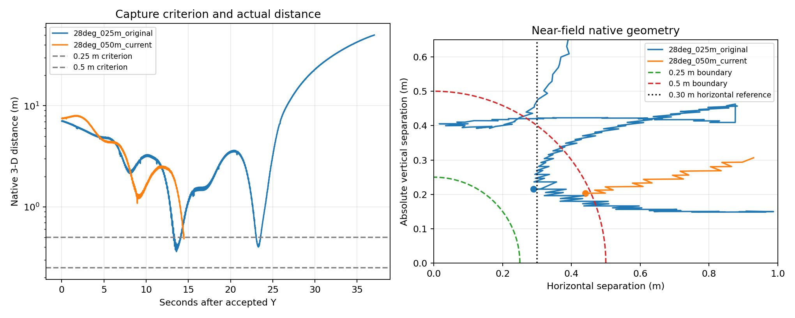

# 28° / 5 m 恢复 0.5 m 判据：单次恒速八字捕获

2026-10-20，按用户明确要求将当前 P7 捕获判据从 0.25 m 恢复为 0.5 m。一次完整恒速八字实验捕获成功并暂停世界。这个结果证明现有控制链能够达到恢复后的判据，**不证明进近精度、速度或总体捕获率提高**。

## 当前修改与实际入口

相机下倾 28°，FOLLOW 高度 5 m，恒速八字 4 m/s、升沉幅值 0.15 m / 频率 0.25 Hz。默认 `p7_guidance.yaml` 与显式 `p7_spatial_candidate.yaml` 的 evaluator 评价/规划半径、旧节点 impact_radius 和 P7 半径字段统一为 0.5 m。红球半径仍为 0.25 m、直径仍为 0.5 m；相机平移、海面安全、KF/BCTRA/MINCO、控制增益、时间门槛均未在本次任务改动。

实际只运行一次 `p7_follow_sitl.py --scene f2 --motion figure_eight --guidance d --capture --config .../p7_guidance.yaml`。这是默认旧 P7 的 `X → MINCO_FOLLOW → Y → 捕获`，没有启用三维候选及其同刻反馈/水平等待修复。这样可避免将判据放宽与切换控制器混为同一项改善。三维候选虽然同步了角度和半径，仍需独立资格，不能用本轮成功替它验收。

原始目录：`data/experiments/20261020_p7_radius05_capture_01/`；独立分析：`data/experiments/20261020_p7_radius05_analysis_01/`。运行冻结 HEAD 为 `3d41c33`，另有完整 working_tree.patch 与逐文件源码快照；随后仓库已出现提交 `3b823a0`。当前在线源码/配置逐文件哈希与实际运行快照一致，不能仅看运行时 HEAD 就误认它使用了旧半径。

## 本轮实际结果

| 项目 | 证据 |
|---|---|
| 终态 | `SUCCESS / CAPTURE_RADIUS_REACHED`，0.5 m |
| 接受 Y 后结果耗时 | 14.478714 s |
| 原生最近三维距离 | 0.484724 m |
| 同刻水平 / 垂直间距 | 0.440034 / 0.203291 m |
| 原生线段首次入径 | Y+14.472613 s；与 evaluator CAPTURE_SEGMENT 的 fraction、原生时刻完全一致 |
| Y 前实际 MINCO 诊断跨度 | 约 6.507 s；不是独立 25 s F2 资格 |
| 制导期间状态 | P7_GUIDANCE 100%，目标可见 100%，未出现失锁/恢复 |
| 实测水平速度 / 加速度峰值 | 5.793727 m/s / 2.082214 m/s² |
| 水平指令变化率峰值 | 2.014746 m/s² |
| 导航最低高度 / 竖直速度峰值 | 0.331210 m / 0.622632 m/s |
| 原生最低 UAV 原点高度 | 0.315939 m；导航和模型原点参考不能混用 |
| 控制权与接口 | 唯一 Tracker、唯一 BCTRA，速度接口；无撤销后旧权威事件 |
| 清理 | 无错误、无任务自有进程残留 |

捕获结果相对速度约 4.5908 m/s，属于半径截获，不代表甲板着陆或速度匹配完成。

仍保留准备阶段的距离回升。若严格按原生水平距离小于 1 m 定义近场，Y+8.958712 s 曾短暂进入，约 20 ms 后退出，Y+14.002721 s 再次进入后捕获；首次只有一个原生样本，且目标存在分段保持，不能把它直接解释为主动退让。该结果也不能记为严格的首次近场命中，不能与“无失锁/恢复”混为一项。

世界暂停有独立证据：50 个 paused stats、跨度约 4.944 s，仿真时钟跨度 0、目标位置跨度 0、目标速度为 0。**独立的暂停后原生模型位姿复核未通过记录要求**：没有 `paused_native_pose` 样本，因此 `world_verified=true`，`native_pose_verified=false`，组合 `freeze.verified=false`。监视器只在 `/world/default/state` 请求成功且解析出模型时写该记录；现有日志不能进一步区分请求未返回和返回内容未解析出模型。不能补造位姿冻结证据，也不能据此反称世界未暂停。本轮不为补证再启动仿真。

## 与原 0.25 m 失败轮比较

对照只使用原 28° / 5 m 恒速八字：`p7_manual_20261019_112340_740393470_984611`。原始 CSV/JSONL/配置及报告保持不变。

| 项目 | 原 0.25 m 轮 | 本次 0.5 m 轮 |
|---|---:|---:|
| 实际终态 | 未捕获，用户退出 | 捕获成功 |
| 原生最近距离 m | 0.360932 | 0.484724，随后停止 |
| 记录轨迹首次进入 0.5 m | Y+13.260359 s，离线反事实判据 | Y+14.472613 s，实际命中线段 |
| 命中前视觉失效 | 原轮直到 Y+23.201874 s 才首次失效 | 无 |

原轮早已进入 0.5 m，只因当时判据是 0.25 m 而没有终止；其最近点也发生在视觉仍有效时。**这排除了“只要不失锁，0.25 m 自然就能命中”的解释。** 放宽判据使任务在后续近场困难出现前结束，是本次终态改善的主要来源。

新轮在 0.5 m 立即暂停，后续轨迹不可观测，因此不能用 0.484724 比 0.360932 大就判定精度下降，也不能断言新轮若继续飞一定无法达到 0.25 m。原轮对 0.5 m 的离线首次入径比本轮更早约 1.21 s，且两轮 Y 入口/升沉相位不同；没有证据声称本次捕获更快。默认视觉制导核心 `p7_visual_guidance.py` 与海面安全源码和原轮相同，Tracker 含后续候选分支/诊断改动，不能称整个运行代码逐字相同的严格 A/B 实验。

## 为什么 0.25 m 未能捕获

1. **默认控制参考没有落入 0.25 m 球内。** `capture_reference()` 使用 `standoff = min(4.5, 0.3 + 2 * descent_remaining)`，其水平参考下限为 0.30 m。水平间距本身已大于 0.25 m，故该参考的稳态目标不能满足 0.25 m 三维判据。动态过冲可能短时穿过参考，但不能靠这种过冲保证命中。这个参考原本针对 0.5 m 设计，本次没有改它。
2. **海面与升沉进一步收紧垂向空间。** 既有接触参考高度约 0.33 m；目标在海平面时，单是垂向间距已为 0.33 m。保持此高度且允许任意水平位置时，0.25 m 也只在目标高于约 0.08 m 的升沉阶段才有非零水平容许范围。目标高度 0.10 m 时容许水平约 0.098 m；峰值 0.15 m 时约 0.173 m，均小于默认 0.30 m 参考。相反，目标在海平面、水平间距 0.30 m 时三维距离约 0.446 m，已经符合 0.5 m。不能为追求小判据降低海面安全层。
3. **固定前视相机的近场走廊也有几何限制。** 用真实相机平移、球半径/高度偏置，在平姿态、相机距球面保留 2 cm、球心前向深度保留 1–2 cm 的条件下，28° 走廊入口距离约 0.280–0.286 m，仍大于 0.25 m。这是给定静态姿态和约束的计算，不证明所有动态轨迹都绝对不可达。此前 38° 三维候选虽然消除了固定 0.30 m 参考，实际捕获交集仍仅占 35/821 个制导样本、连续窗口 0.20–0.40 s，最终也未命中。
4. **估计与动态执行余量不足，随后才失锁。** 原 28° 最近点水平 0.289756 m、垂直 0.215205 m，合成 0.360932 m；该点约 Y+13.59 s，早于首次图像无效约 9.61 s。后续真实球体从下缘离场已由原生全姿态几何确认。定位误差仍会影响厘米级目标，但不能单独解释参考不满足半径，也不能把失败归咎于 KF 参数。未使用真值在线校正或调 Q/R。

如后续坚持 0.25 m，需要先设计并离线验证一个同时位于捕获球、海面安全、相机可见区域内且有实测相对速度制动余量的终端参考；不能只缩小评价半径。当前按用户要求保持 0.5 m，已完成指定的一次实际实验，不追加复飞。

## 检查与复算

当前配置相关测试 113 passed；可运行回归 2268 passed、2 skipped、3 warnings；两个节点包构建成功；flake8、5 个 shell 语法及 diff 检查通过。两个依赖缺失历史 F3 配置的未改动 P6 模块仍排除，未补造其输入。测试绑定本次参数恢复后的源码，不沿用此前计数。

[原生对比 JSON](audit/p7_radius05_20261020/comparison.json)、[软件检查](audit/p7_radius05_20261020/software_checks.json)、[输入 SHA256](audit/p7_radius05_20261020/input_SHA256SUMS.json)、[复算脚本](audit/p7_radius05_20261020/analyze.py)。左图距离为对数轴，右图只绘制原生距离小于 1 m 的样本；锯齿包含目标 set_pose 的分段保持，不能直接解释成定位噪声。

